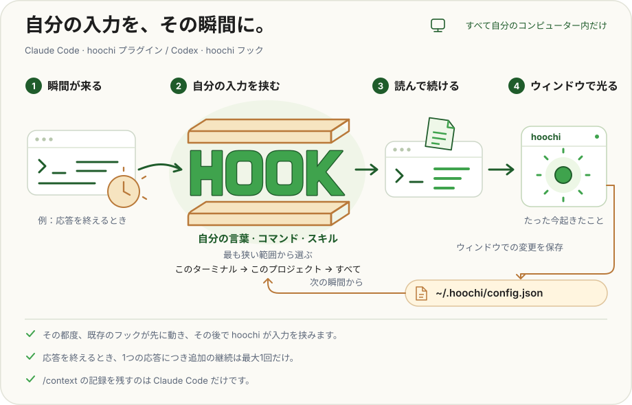

<p align="center">
  
</p>

<h1 align="center">hookwich</h1>

<p align="center">
  <b>コーディングエージェントのあらゆる瞬間に、自分のルールを差し込むリモコン。</b><br />
  Claude Code と Codex が働く瞬間を図で見せ、押すだけでそこに言葉・コマンド・スキルが入ります。JSON は一行も書きません。
</p>

<p align="center">
  <a href="https://github.com/minjund/hookwich/releases/latest"></a>
  <a href="LICENSE"></a>
  
  
  <a href="https://github.com/minjund/hookwich/stargazers"></a>
</p>

<p align="center">
  <a href="#こんなときに">こんなときに</a> · <a href="#インストール">インストール</a> · <a href="#1分で最初のフック">1分で最初のフック</a> · <a href="#しくみ">しくみ</a> · <a href="#よくある質問">よくある質問</a> · <a href="https://github.com/minjund/hookwich/releases">リリース</a>
</p>

<p align="center">
  <a href="README.md">English</a> · <a href="README.ko.md">한국어</a> · <b>日本語</b> · <a href="README.zh.md">中文</a>
</p>

<p align="center">
  
</p>

```sh
claude plugin install hookwich --marketplace minjund/hookwich
```

---

「テストは回した？」「日本語で答えて」「消す前に理由を言って」。エージェントに毎回同じことを言っているなら、
それは**フック**が代わりに言えます。問題は、フックが誰も開きたくない JSON ファイルの中に隠れていることです。

**hookwich はその JSON を、画面の隅の小さなウィンドウに変えます。** エージェントが働く瞬間が図になり、
いま過ぎた瞬間が光ります。箱を押して、入れるものを書いて、保存すれば終わり。次の瞬間からすぐ入ります。

## こんなときに

| こんなことが面倒なら | hookwich では | すると |
|---|---|---|
| テストが落ちたまま「できました」と言われる | **回答の終わり** → コマンド `npm test` → **失敗したときだけ** | 失敗すると Claude がその内容を読んで、もう一度直します |
| メッセージのたびに「日本語で答えて」と付ける | **メッセージを送るとき** → 言葉 `日本語で答えて` | すべてのメッセージに自動で付きます |
| 危ないコマンドが黙って通ってしまう | **ツールを使う前** → `Bash` だけ → 言葉 `消したり上書きしたりするコマンドは、先に理由を言って` | シェルコマンドを使うときだけその言葉が入ります |
| 会話を開くたびにブランチの状態を説明する | **会話の開始** → コマンド `git status -sb` | Claude がいまの状態を知った上で始めます |
| このリポジトリだけのルールがある | **このプロジェクト** タブで入れる | そのプロジェクトの会話にだけ入ります |
| レビュー用のターミナルだけ別にしたい | **このターミナル** タブ → **回答の終わり** → スキル `code-review` | そのターミナルでだけ、回答のたびにもう一度レビューします |
| 会話ごとに一度だけ伝えたい | 入れるときに **会話ごとに一度** をオン | 一つの会話で一度動き、新しい会話や /clear のあとにまた動きます |
| プラグインが何のフックを入れたか分からない | 灰色の数字が付いた瞬間を押す | どのコマンドをいつ動かすかが見え、スイッチで切れます |
| 会話がいつ圧縮されるか不安 | 図の **会話の開始** と **会話を短くする前** を見る | どれだけ埋まったか、自動圧縮まであとどれだけかがリアルタイムで出ます |
| 使わないスキルが場所を取っている | **スキルのオン・オフ** | オフにしたスキルは Claude が受け取る一覧から外れます |

## できること

- **すべての瞬間をひと目で** — エージェントの流れが一枚のワークフローに。いま過ぎた瞬間が光ります。
- **言葉・コマンド・スキルをどこにでも** — 押して、書いて、保存。失敗したときだけ、会話ごとに一度、特定のツールだけも。
- **すべて · プロジェクト · ターミナル** — ルールごとに範囲を決め、いちばん狭い場所が優先。
- **チャットしている場所に合わせます** — 入力しているターミナルとそのプロジェクトに、ウィンドウが自分で切り替わります。
- **隠れたフックまで見えます** — プラグインやアプリが入れたフックが何をするか、どのアプリが入れたかを見て、オン・オフできます。
- **/context をリアルタイムで** — どれだけ埋まったか、圧縮まであとどれだけかを図の中で。
- **スキルのオン・オフ** — 使わないスキルを切って、場所を空けます。
- **ボタンひとつでアップデート** — 開いている会話まで自動で新しい版に。
- **軽くて静か** — 3.8MB のネイティブアプリ（Electron ではない）。待機中は CPU をほとんど使いません。
- **4 言語 · ライトとダーク**

## インストール

**1. プラグイン**（ターミナルで）

```sh
claude plugin install hookwich --marketplace minjund/hookwich
```

または Claude Code の中で

```
/plugin marketplace add minjund/hookwich
/plugin install hookwich@hookwich
```

**2. ウィンドウ**は、Claude Code の会話を初めて始めたときに自動で入ります（macOS 11 以降、Apple シリコン・Intel）。手で入れるなら：

```sh
mkdir -p ~/.hookwich && cd ~/.hookwich
curl -fsSLO https://github.com/minjund/hookwich/releases/latest/download/Hookwich-macos-arm64.zip
curl -fsSL https://github.com/minjund/hookwich/releases/latest/download/Hookwich-macos-arm64.zip.sha256 | shasum -a 256 -c
ditto -x -k Hookwich-macos-arm64.zip . && open Hookwich.app
```

**3. Codex（任意）** ウィンドウの Codex タブで **Codex を接続** を押し、Codex で `/hooks` を一度入力して hookwich のフックを信頼してください。

**新しい版：** ウィンドウ上の **アップデート** を押すか、`claude plugin update hookwich@hookwich` を実行します。開いている会話は数秒で
新しい版を読み込み直します（0.1.16 から。それより古い版から上げるときだけ、開いている会話ごとに `/reload-plugins` を一度入力してください）。
hookwich を入れる前に開いた会話には hookwich がないので、その会話は始め直してください（`claude --continue` で続きから再開できます）。

## 1分で最初のフック

1. Claude Code の会話を新しく始めます。右下に 🥪 のバブルが出たら押します。
2. 図の **回答の終わり** を押し、**ここに追加** → **コマンド** を選び、`npm test` と書いて **失敗したときだけ** を選びます。
3. **保存** を押します。
4. Claude に何か直させてみてください。テストが落ちたまま終えようとすると、失敗の内容を読んでもう一度直します。

`/hookwich` と入力するとウィンドウを表示・非表示にします。`×` でバブルにたたみ、バブルを右クリックするとメニューバーに隠せます。

## しくみ

<p align="center">
  
</p>

- ファイルはすべて `~/.hookwich` にあります：`config.json`（入れたもの）、`activity-*.json`（いま起きたこと）、`places.json`（見たプロジェクトと
  ターミナル）、`parked.json`（オフにしたフック）、`once-*.json`（会話ごとに一度の項目がどの会話で動いたか）、`context/`（ターミナルごとの /context）。ほかの設定ファイルを変えるときは、先に `~/.hookwich/backups/` にバックアップします。

## よくある質問

**安全ですか？** 入れたコマンドは、その瞬間が来るたびに自分のコンピューターで、自分と同じ権限で動きます。自分で実行しても
よいコマンドだけを入れてください。コマンドは 30 秒で止まります。

**エージェントが遅くなりますか？** 言葉とスキルはすぐ入ります。コマンドは、そのコマンドが動く分だけかかります。

**開くと macOS が警告します。** アプリは仮の署名はしていますが、Apple の公証は受けていません。プラグインのように `curl` で取ると
そのまま開きます。ブラウザで取った場合は `Hookwich.app` を右クリックして **開く** を一度選んでください。

**もとのフックを変えますか？** 自分でオフにしたり戻したりしたときだけで、いつもバックアップを残します。Codex のフックは Codex の
`/hooks` と同じように、その場で切ります。

**スキルがたくさんあるのに、一覧が短いのはなぜ？** スキルの画面は、そこで切り替えられるものだけを並べます。claude.ai から同期した
スキルは claude.ai で切り替え、プラグインのスキルはプラグインごとにしか切れないので、プラグインは一行で出ます。

**Windows・Linux は？** まだです。いまはウィンドウが macOS 専用です。

## 開発者向け

```sh
git clone https://github.com/minjund/hookwich && cd hookwich
cd app && npm install
npm run tauri dev                                         # ウィンドウを動かす
npm run tauri build -- --target universal-apple-darwin    # Hookwich.app を作る
npm test                                                  # ウィンドウの状態機械のテスト
cd src-tauri && cargo test                                # ウィンドウ（Rust）のテスト
cd ../.. && claude plugin test plugin                     # プラグインのテスト
```

- `plugin/` は Claude Code 側です（`classic.*` フック、`prompt.submit`・`prompt.edit`、/context の記録を使う TypeScript のモッド）。
- `app/` はウィンドウです。Tauri（Rust）+ React + 無料の [affectUI](https://www.affectui.com) コンポーネント、そして Codex のフック実行役
  （`hookwich hook codex <Event>`）が入っています。ウィンドウの状態（保存、アップデート、お知らせ、追いかけ）は `app/src/lib/machines.ts` に
  書いてあります。エージェント向けの案内は [AGENTS.md](AGENTS.md) にあります。

Node 23.6 以降、Rust、Xcode コマンドラインツールが必要です。

## ライセンス

[MIT](LICENSE)
