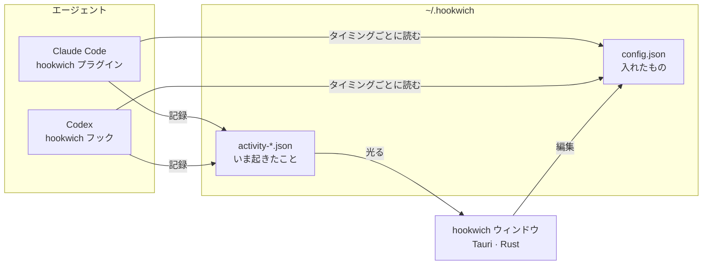

<p align="center">
  
</p>

<h1 align="center">hookwich</h1>

<p align="center">
  <b>コーディングエージェントが働くタイミングの合間に、なんでも挟み込もう。</b><br />
  Claude Code と Codex が働くすべてのタイミングを図で見せ、そこに言葉・コマンド・スキルを入れられる小さなウィンドウです。
</p>

<p align="center">
  <a href="https://github.com/minjund/hookwich/releases/latest"></a>
  <a href="LICENSE"></a>
  
  
  <a href="https://github.com/minjund/hookwich/stargazers"></a>
</p>

<p align="center">
  <a href="#インストール">インストール</a> · <a href="#すぐに試す">すぐに試す</a> · <a href="#しくみ">しくみ</a> · <a href="#よくある質問">よくある質問</a> · <a href="https://github.com/minjund/hookwich/releases">リリース</a>
</p>

<p align="center">
  <a href="README.md">English</a> · <a href="README.ko.md">한국어</a> · <b>日本語</b> · <a href="README.zh.md">中文</a>
</p>

<p align="center">
  
</p>

```sh
claude plugin install hookwich --marketplace minjund/hookwich
```

---

Claude Code や Codex が働くとき、同じタイミングが何度もやってきます。会話が始まり、メッセージを送り、
ツールを使おうとし、回答を終える。その一つひとつが **フック** で、フックはエージェントに自分の習慣を教える方法です。
でもフックは、ほとんどの人が開かない JSON ファイルの中にあります。

**hookwich はそれを画面に出します。** 画面の隅に小さなウィンドウが浮かび、タイミングを図で描き、
クリックするだけでどのタイミングにも何かを入れられます。コードも設定ファイルもいりません。

## できること

- **すべてのタイミングを一目で** — 公式の [Claude Code フックのライフサイクル図](https://code.claude.com/docs/en/hooks#hook-lifecycle)
  にならって描き、Codex には Codex の図があります。箱はすべて押せて、いま起きたタイミングが光ります。
- **言葉、コマンド、スキル** — 言葉はそのタイミングでエージェントが読みます。コマンドはあなたのパソコンで動き、結果を渡します
  （いつも、または失敗したときだけ）。スキルは名前で呼びます。一つずつオン・オフ、一度だけ、特定のツールだけ、も選べます。
- **すべて・プロジェクトごと・ターミナルごと** — 一番近いものが優先されます。ほかの場所の設定をワンクリックで写せて、
  上書きせず、元に戻すこともできます。
- **チャットしている場所に合わせる** — ターミナルで入力を始めると、ウィンドウがその AI・プロジェクト・ターミナルに切り替わります。
  ターミナルごとに色が違い、別のターミナルに移るとお知らせします。
- **すでにあるフックも見える** — 自分の設定、プラグイン（フックで動くスキルを含む）、Codex のフックが灰色の数字で出て、
  マウスを乗せると名前が見え、オフにしたり戻したりできます。Codex は `/hooks` と同じやり方で切り替えるので、信頼はそのままです。
- **自分で入れたものを一目で** — 最近入れたものが下にスイッチと削除ボタン付きで並び、全一覧は場所ごとにまとめて開きます。押せばすぐ編集できます。
- **/context を図の中でリアルタイムに** — ライフサイクルの図に、いまチャットしている会話のコンテキストが溶け込んでいます。
  **会話の開始**の横にどれだけ埋まったかと最初に読み込まれた分、ループの中に会話の分、**会話を短くする前**に自動圧縮まで
  どれだけ残っているかが出ます。そこにマウスを乗せると MCP サーバー、メモリファイル、プラグインごとのスキル、
  エージェントまで見えます。パソコンの中で数えるので、リクエストは増えません。
- **小さくて軽い** — Tauri（Rust）製の 3.7MB のアプリで、Electron ではありません。開いているチャットを macOS カーネルから直接読んで
  約 7ms で見つけ、隠している間は何も読みません。
- **自分で更新** — ウィンドウはいつもプラグインと同じバージョンです。プラグインが新しくなると、次の会話でウィンドウも入れ替わります。
  SHA-256 と署名を確かめてからです。
- **4 言語、ライト・ダーク** — English、한국어、日本語、中文。パソコンの設定に合わせるか、ライト・ダークを選べます。

## インストール

**1. プラグイン** — ターミナルで

```sh
claude plugin install hookwich --marketplace minjund/hookwich
```

または Claude Code の中で

```
/plugin marketplace add minjund/hookwich
/plugin install hookwich@hookwich
```

**2. ウィンドウ** は Claude Code の会話を初めて始めたときに自動で取得されます（macOS 11 以降、Apple シリコン・Intel）。手動で入れるには：

```sh
mkdir -p ~/.hookwich && cd ~/.hookwich
curl -fsSLO https://github.com/minjund/hookwich/releases/latest/download/Hookwich-macos-arm64.zip
curl -fsSL https://github.com/minjund/hookwich/releases/latest/download/Hookwich-macos-arm64.zip.sha256 | shasum -a 256 -c
ditto -x -k Hookwich-macos-arm64.zip . && open Hookwich.app
```

**3. Codex（任意）** — ウィンドウの Codex タブで **Codex を接続** を押し、Codex で `/hooks` を一度入力して hookwich のフックを信頼してください。

**更新：** `claude plugin update hookwich@hookwich` のあと、Claude Code を起動し直してください。自動で新しい版を
受け取るには `/plugin` → **Marketplaces** → hookwich → **Enable auto-update** を一度オンにします。ウィンドウは次の会話で
プラグインと同じ版に替わります。

## すぐに試す

1. Claude Code の会話を新しく始めます。右下に 🥪 のバブルが出たら押します。
2. **回答の終わり** を押し、**コマンド** を選んで `npm test` と入れ、**失敗したときだけ** を選びます。
3. Claude に変更を頼んでみてください。テストが失敗したまま終えようとすると、失敗内容を読んで通るまで直し続けます。

`/hookwich` と入力すると表示・非表示を切り替えます。`–` でバブルにたたみ、`×` でメニューバーに隠します。

## しくみ



- タイミングごとに、もとからあるフックが先に動き、そのあと hookwich が一番近い場所（このターミナル、なければこのプロジェクト、
  なければすべて）でオンになっているものを入れます。
- エージェントが回答を終えようとするときは、**1 回の回答につき多くても 1 回** だけ続けさせるので、ループしません。
- すべてはあなたのパソコンの `~/.hookwich` だけにあります。`config.json`（入れたもの）、`activity-claude.json`・`activity-codex.json`、
  `places.json`（見たプロジェクト・ターミナル）、`parked.json`（オフにしたフック）、`control.json`（表示・非表示）、`context/`（ターミナルごとの /context）です。
  hookwich が変えるファイルは、先に `~/.hookwich/backups/` にバックアップします。

## よくある質問

**安全ですか？** 入れたコマンドは、そのタイミングが来るたびにあなたのパソコンで、あなたと同じ権限で動きます。
自分で実行してもよいコマンドだけを入れてください。コマンドは 30 秒で止まります。

**エージェントが遅くなりますか？** 言葉とスキルはすぐ入ります。コマンドはそのコマンドが動く時間だけかかります。
ウィンドウは待機中 CPU 1% 未満で、隠している間は何も読みません。

**開くと macOS に警告されます。** アプリはアドホック署名をしていますが、Apple の公証は受けていません。プラグインのように `curl` で
取得すればそのまま開きます。ブラウザで取得した場合は、`Hookwich.app` を右クリックして **開く** を一度選んでください。

**もとからあるフックを変えますか？** オフにしたり戻したりしたときだけで、いつもバックアップを残します。Codex のフックは
Codex の `/hooks` とまったく同じように、その場で切り替えます。

**Windows・Linux は？** まだです。いまはウィンドウが macOS 専用です。

## 開発者向け

```sh
git clone https://github.com/minjund/hookwich && cd hookwich
cd app && npm install
npm run tauri dev                                         # ウィンドウを起動
npm run tauri build -- --target universal-apple-darwin    # Hookwich.app を作る
cd src-tauri && cargo test                                # ウィンドウのテスト
cd ../.. && claude plugin test plugin                     # プラグインのテスト
```

- `plugin/` — Claude Code 側（`classic.*` フックと `prompt.edit` を使う TypeScript のモッド）。
- `app/` — ウィンドウ：Tauri（Rust）+ React + 無料の [affectUI](https://www.affectui.com) コンポーネント、そして Codex のフック実行役
  （`hookwich hook codex <Event>`）。

Node 20+、Rust、Xcode コマンドラインツールが必要です。

## クレジット

ライフサイクルの図は、公式 [Claude Code フック図](https://code.claude.com/docs/en/hooks#hook-lifecycle) の配置にならって hookwich が
描き直したもので、図のファイルは含まれていません。UI 部品は [affectUI](https://www.affectui.com)（無料アイテム、MIT）から。
図の一部とアイコンは Codex と一緒に描きました。

## ライセンス

[MIT](LICENSE)
