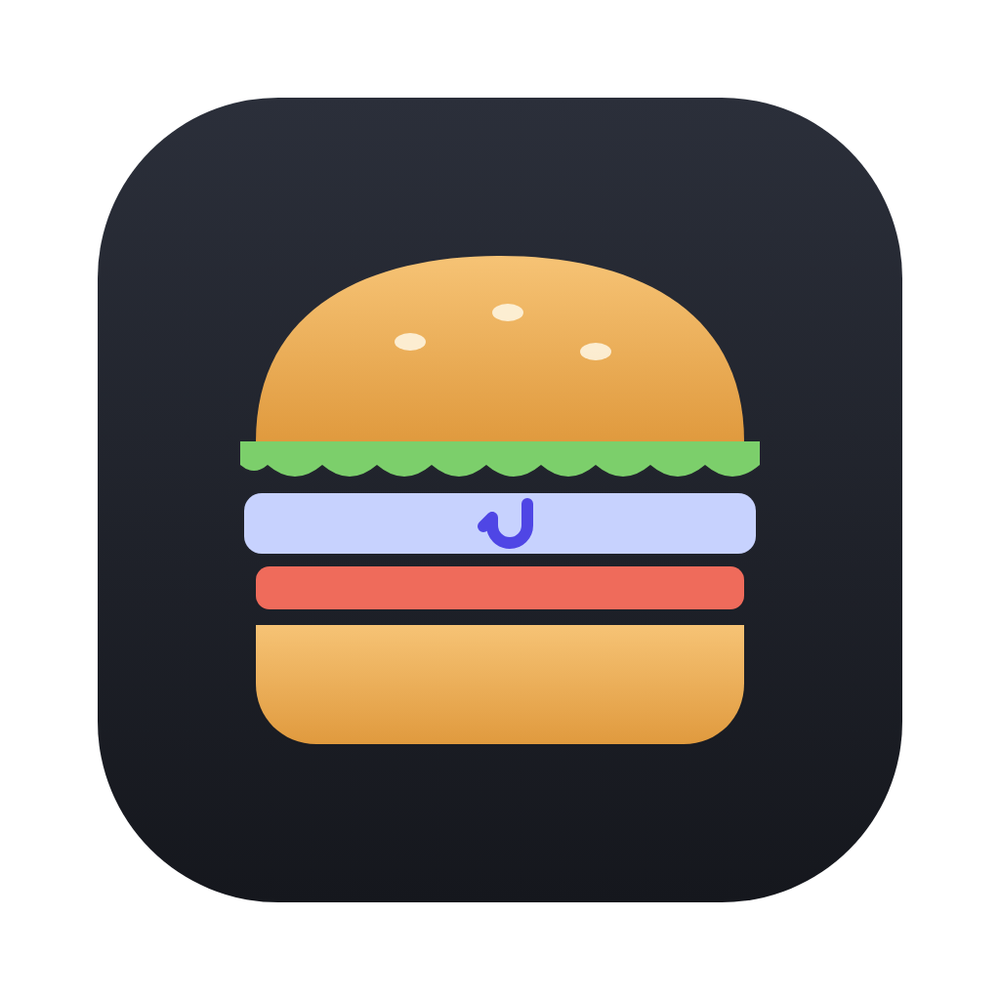
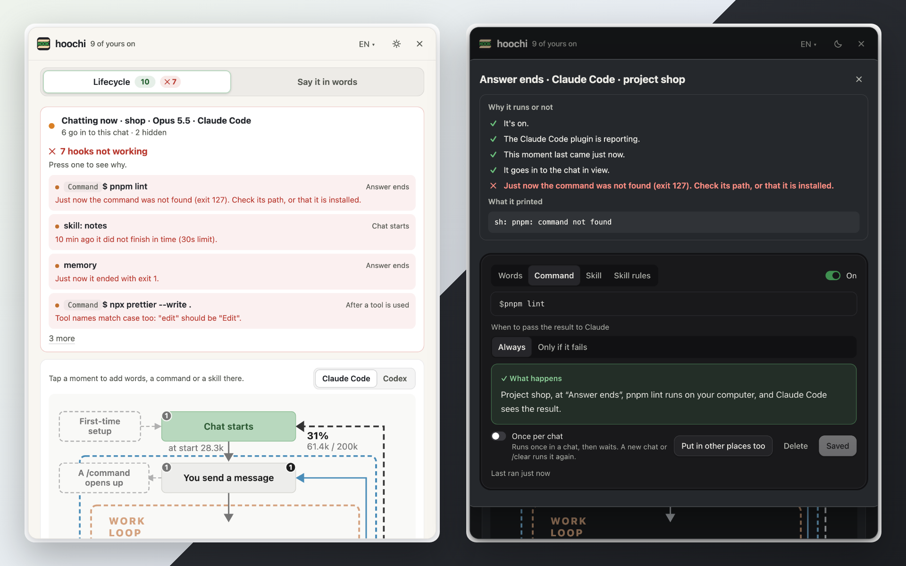

<p align="center">
  
</p>

<h1 align="center">hoochi</h1>

<p align="center">
  <b>このフック、なぜ動かない？</b><br />
  hoochi は Claude Code と Codex のフックを、エージェントが確かめる順番どおりに一つずつ確かめ、最初に止まった理由を一文で伝えます。直すのはその場で、または言葉で。
</p>

<p align="center">
  <a href="https://github.com/minjund/hoochi/releases/latest"></a>
  <a href="LICENSE"></a>
  
  
  <a href="https://github.com/minjund/hoochi/stargazers"></a>
</p>

<p align="center">
  <a href="#見つけられること">見つけられること</a> · <a href="#インストール">インストール</a> · <a href="#1分で確かめる">1分で確かめる</a> · <a href="#しくみ">しくみ</a> · <a href="#よくある質問">よくある質問</a> · <a href="https://github.com/minjund/hoochi/releases">リリース</a>
</p>

<p align="center">
  <a href="README.md">English</a> · <a href="README.ko.md">한국어</a> · <b>日本語</b> · <a href="README.zh.md">中文</a>
</p>

<p align="center">
  
</p>

```sh
claude plugin install hoochi --marketplace minjund/hoochi
```

---

フックを入れたのに何も起きない。その瞬間がそもそも来ていない？プロジェクトのルールに隠れた？ツール名を
`Edit` ではなく `edit` と書いた？インストールされていなくてコマンドが 127 で終わった？Claude Code は教えてくれません。
**hoochi は教えます。**

hoochi はフックごとに、エージェントと同じ順番で確かめます。オンか、その AI はつながっているか、その瞬間は来るか、
いまのチャットに届くか、ツールの条件は合うか、その瞬間に言葉はモデルに届くか、最後の実行はどう終わったか。
最初に引っかかったところが答えで、一文で示します。

## 見つけられること

| 動かない理由 | hoochi の言うこと |
|---|---|
| プロジェクトやターミナルにその瞬間のルールが別にあり、全体のルールがそこでは隠れる | どこが勝つか、そして **…にも入れる** |
| ツール名の大文字・小文字が違う、`Edit\|Write` のように一つの名前で書いた、もう一方の AI の名前を書いた（Codex はファイル編集をすべて `apply_patch` と呼びます） | *ツール名は大文字・小文字まで同じでないと合いません:「edit」→「Edit」* |
| マッチャーが実際に来たどのツールにも合わない | そのマッチャーと、実際に来たツール |
| モデルが聞けない瞬間（チャットの終わり、圧縮の前）に入れた言葉 | *ここではコマンドだけが動きます* |
| コマンドが見つからない、時間切れ、失敗 | どう終わったかと出力 |
| プラグインのフックが黙って失敗する、時間切れになる | Claude Code 自身が残した実行記録から |
| たまにだけ切れるフック(自分で実行すると問題なし) | 直近 7 日の回数、会話の数、日ごとの棒、直近 24 時間 |
| フックのせいか、Claude Code やこのコンピューターのせいかわからない | *同じタイミング(UserPromptSubmit)のほかのフック 3 件は同じ期間に失敗 0 回。このフックの問題です* |
| まだ動くが制限ぎりぎり | *遅いときは制限 20 秒のうち 17.7 秒かかります。いつかタイムアウトで切られます* |
| Codex のフックがつながっていない | つなぐボタンひとつ |
| Team・Enterprise アカウントでプラグインに届かない瞬間 | どの瞬間か、薄く表示 |

ライフサイクルの画面は、動いていないフックから見せます。失敗しているものが先です。押すと確認の各段階がすべて見えます。
となりのタブで「lint のフック、なぜ動かない？」「何が壊れてる？」と聞いても大丈夫。ルールごとにいまの状態を付けて答え、
その場でオフにしたり、直したり、消したりできます。

## できること

- **動かない理由を段階ごとに** — hoochi で入れたルールも、設定ファイルやプラグインにもとからあるフックも。
- **実行ごとの記録** — コマンドがどう終わったか、どれだけかかったか、失敗したとき何を出力したか。
- **アイコンの数字 = 動いていないフックの数** — 畳んでいても赤い数字で。すべて動いていれば数字なし。
- **診断をコピー** — 確認したこと、直近 7 日、最近の失敗をテキストで。フックの担当者にそのまま送れます。
- **見たところで直す** — スイッチ、ポップアップで編集、または言葉で:「テストは pnpm で」「これを Codex にも」。
- **すべての瞬間をひと目で** — エージェントの流れを一枚の図に。いま起きた瞬間が光ります。
- **全体 · プロジェクト · ターミナル** — いちばん狭い場所が勝ち、そうなったときは画面が伝えます。
- **チャットしている場所についていく** — 入力中のターミナルとそのプロジェクトにウィンドウが切り替わります。
- **/context をリアルタイムで** — どれだけ埋まったか、自動圧縮まであとどれくらいかを図の中で。
- **スキルのオン・オフ** — 使わないスキルを切って、余裕を作ります。
- **ボタンひとつで更新** — 開いているチャットも自動で新しい版に。
- **軽くて静か** — ネイティブアプリ（Electron ではありません）、待機中は CPU をほとんど使いません。4 言語、ライト・ダーク。

## インストール

> **hookwich を使っていた場合** 名前が hoochi に変わりました。新しいプラグインを入れてから古いものを外してください: `claude plugin install hoochi --marketplace minjund/hoochi`、続けて `claude plugin uninstall hookwich@hookwich`。新しいプラグインで最初にチャットを開くと、入れたものが `~/.hookwich` から `~/.hoochi` に移り、ウィンドウが Codex のフックも新しいアプリにつなぎ直します。

**1. プラグイン**（ターミナルで）

```sh
claude plugin install hoochi --marketplace minjund/hoochi
```

または Claude Code の中で

```
/plugin marketplace add minjund/hoochi
/plugin install hoochi@hoochi
```

**2. ウィンドウ**は、Claude Code の会話を初めて始めたときに自動で入ります（macOS 11 以降、Apple シリコン・Intel）。手で入れるなら：

```sh
mkdir -p ~/.hoochi && cd ~/.hoochi
curl -fsSLO https://github.com/minjund/hoochi/releases/latest/download/Hoochi-macos-arm64.zip
curl -fsSL https://github.com/minjund/hoochi/releases/latest/download/Hoochi-macos-arm64.zip.sha256 | shasum -a 256 -c
ditto -x -k Hoochi-macos-arm64.zip . && open Hoochi.app
```

**3. Codex（任意）** ウィンドウの Codex タブで **Codex を接続** を押し、Codex で `/hooks` を一度入力して hoochi のフックを信頼してください。

**新しい版：** ウィンドウ上の **アップデート** を押すか、`claude plugin update hoochi@hoochi` を実行します。開いている会話は数秒で
新しい版を読み込み直します（0.1.16 から。それより古い版から上げるときだけ、開いている会話ごとに `/reload-plugins` を一度入力してください）。
hoochi を入れる前に開いた会話には hoochi がないので、その会話は始め直してください（`claude --continue` で続きから再開できます）。

## 1分で確かめる

1. Claude Code のチャットを開きます。右下に 🥪 の吹き出しが出たら押します。
2. **ライフサイクル** の画面が、動いていないフックから見せます。空なら、すべてのフックがすべての確認を通っています。
3. 一行を押すと、確認の各段階がすべて見えます。止まった段階は赤く、出力も一緒に。
4. その場で直すか（スイッチ、編集、**…にも入れる**）、**言葉で入れる** タブで言葉で直します。

フックを入れるときも言葉で:「答えが終わったら `npm test` を回して、失敗したときだけ伝えて」。図の瞬間を押して
**コマンド** → `npm test` → **失敗したときだけ** → **保存** でも入れられます。

`/hoochi` でウィンドウを表示・非表示にします。`×` で吹き出しにたたみ、吹き出しを右クリックするとメニューバーに隠れます。

## しくみ

<p align="center">
  
</p>

- ファイルはすべて `~/.hoochi` にあります：`config.json`（入れたもの）、`activity-*.json`（いま起きたこと）、`places.json`（見たプロジェクトと
  ターミナル）、`parked.json`（オフにしたフック）、`once-*.json`（会話ごとに一度の項目がどの会話で動いたか）、`context/`（ターミナルごとの /context）。ほかの設定ファイルを変えるときは、先に `~/.hoochi/backups/` にバックアップします。
- フックの結果：プラグインと Codex のフックが、入れたものの実行ごとに結果を残します（`activity-*.json` の `runs`）。ほかで設定された
  フックは、Claude Code がチャットごとに残す実行記録（`~/.claude/projects/*/*.jsonl`、直近 3 日のうち新しい 40 件）をウィンドウが読むだけです。

## よくある質問

**安全ですか？** 入れたコマンドは、その瞬間が来るたびに自分のコンピューターで、自分と同じ権限で動きます。自分で実行しても
よいコマンドだけを入れてください。コマンドは 30 秒で止まります。

**エージェントが遅くなりますか？** 言葉とスキルはすぐ入ります。コマンドは、そのコマンドが動く分だけかかります。

**開くと macOS が警告します。** アプリは仮の署名はしていますが、Apple の公証は受けていません。プラグインのように `curl` で取ると
そのまま開きます。ブラウザで取った場合は `Hoochi.app` を右クリックして **開く** を一度選んでください。

**もとのフックを変えますか？** 自分でオフにしたり戻したりしたときだけで、いつもバックアップを残します。Codex のフックは Codex の
`/hooks` と同じように、その場で切ります。

**スキルがたくさんあるのに、一覧が短いのはなぜ？** スキルの画面は、そこで切り替えられるものだけを並べます。claude.ai から同期した
スキルは claude.ai で切り替え、プラグインのスキルはプラグインごとにしか切れないので、プラグインは一行で出ます。

**hoochi が作っていないフックも見えますか？** はい。Claude Code のフックは、Claude Code がチャットごとに残す記録から
実行がどう終わったかを読みます。Codex はフックを実行した結果を残さないため、ほかで設定された Codex のフックは設定まで
しか確かめられません。

**Windows・Linux は？** まだです。いまはウィンドウが macOS 専用です。

## 開発者向け

```sh
git clone https://github.com/minjund/hoochi && cd hoochi
cd app && npm install
npm run tauri dev                                         # ウィンドウを動かす
npm run tauri build -- --target universal-apple-darwin    # Hoochi.app を作る
npm test                                                  # ウィンドウの状態機械のテスト
cd src-tauri && cargo test                                # ウィンドウ（Rust）のテスト
cd ../.. && claude plugin test plugin                     # プラグインのテスト
```

- `plugin/` は Claude Code 側です（`classic.*` フック、`prompt.submit`・`prompt.edit`、/context の記録を使う TypeScript のモッド）。
- `app/` はウィンドウです。Tauri（Rust）+ React + 無料の [affectUI](https://www.affectui.com) コンポーネント、そして Codex のフック実行役
  （`hoochi hook codex <Event>`）が入っています。ウィンドウの状態（保存、アップデート、お知らせ、追いかけ）は `app/src/lib/machines.ts` に
  書いてあります。エージェント向けの案内は [AGENTS.md](AGENTS.md) にあります。

Node 23.6 以降、Rust、Xcode コマンドラインツールが必要です。

## ライセンス

[MIT](LICENSE)
