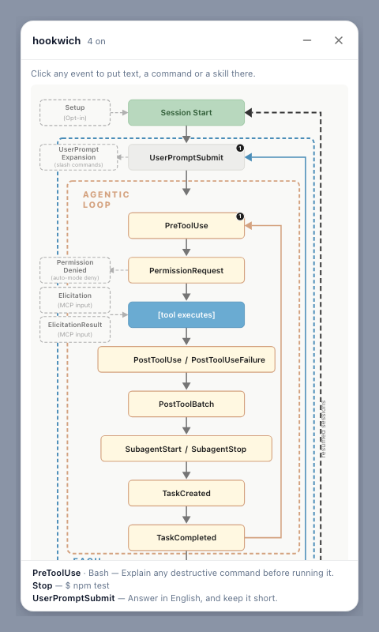

<p align="center"></p>

<h1 align="center">hookwich</h1>

<p align="center"><b>Claude Code が動くまさにその瞬間に、やってほしいことを伝えましょう。</b><br>
画面の隅の小さなウィンドウが、Claude の作業の流れを図で見せます。<br>
タイミングを押して、そこで入れる言葉・コマンド・スキルを選ぶだけです。</p>

<p align="center"><a href="README.md">English</a> · <a href="README.ko.md">한국어</a> · <b>日本語</b> · <a href="README.zh.md">中文</a></p>

---

## 何に使うの？

Claude Code が作業するとき、同じタイミングが何度も来ます。会話が始まり、あなたがメッセージを送り、
Claude がツールを使い（コマンド実行、ファイル編集）、Claude が回答を終える……。

hookwich を使えば、コードを書かずに、そのタイミングごとに何かを付け加えられます。

| 入れるもの | どうなるか | 例 |
|---|---|---|
| **言葉** | そのタイミングで Claude が読みます。 | メッセージを送るたびに「英語で答えてください。」 |
| **コマンド** | あなたのパソコンで実行されます。結果をいつも渡すか、失敗したときだけ渡すかを選べます。 | 回答を終えるときに `npm test` を失敗時だけ → テストが通るまで Claude が直し続けます。 |
| **スキル** | インストール済みのスキルを使うよう Claude に頼みます。 | 回答を終えるときに `code-review`。 |

一つずつオン・オフでき、**一度だけ** を選ぶと一回動いたあと自動でオフになります。
ツールを使うタイミングでは、どのツールのときだけにするかも選べます。

<p align="center"></p>

## どこに適用される？

入れたものは次の 3 か所のどれかに入ります。

- **すべて**：すべての会話。
- **このプロジェクト**：そのプロジェクトフォルダで開いた会話だけ。
- **このターミナル**：そのターミナルのウィンドウ・タブだけ。そこで Claude Code や Codex を再起動してもそのままです。

タイミングごとに一番近いものが優先されます。このターミナル → このプロジェクト → すべて、の順です。
オフにした項目も場所を取るので、特定のプロジェクトだけ「すべて」の項目を黙らせることもできます。
プロジェクト・ターミナルの設定はあなたのパソコンだけに保存され、プロジェクトの中には入りません。

タブの下のボタンで、ほかの場所の設定を写せます。上書きはせず、すでにあるものは飛ばします。直前の写しは **元に戻す** で戻せます。
**「すべて」の値を読み込む**、**プロジェクトの値を読み込む**（ターミナルで）、**すべてのプロジェクトに適用**、**「すべて」に適用** があります。

チャットしている場所に合わせるとき、プロジェクトのフォルダのターミナルなら **このプロジェクト**、そうでなければ **すべて** が先に開きます。

すでにあるフックも見えます。Claude Code の設定、プラグイン（フックで動くスキルを含む）、Codex の `hooks.json` にあるフックは、
タイミングごとに左上の **灰色の数字** で出て、箱を開くと名前が見えます。黒い数字は hookwich で入れたものです。
すでにあるフックには、それぞれオン・オフのスイッチがあります。Claude Code の設定のフックは、オフにすると脇（`~/.hookwich/parked.json`）に移し、オンで元に戻します。
Codex のフックは `/hooks` と同じやり方でその場でオフにするので、信頼はそのままです。プラグインのフックはプラグイン全体でしか切り替えられないため、先に確認します。
変更の前には必ず `~/.hookwich/backups/` にバックアップを残します。

## Claude Code と Codex

ウィンドウにはそれぞれのタブがあります。Codex には Codex のタイミングを描いた別の図があります。
Codex タブを使うには **Codex を接続** を一度押します。hookwich は `~/.codex/hooks.json` の最後に自分の項目だけを追加し、
元のフックはそのまま、横にバックアップも残します。そのあと Codex で `/hooks` を一度入力し、hookwich のフックを信頼してください。
**接続を解除** で取り除けます。

## ウィンドウ

- ほかのウィンドウの上に、右下の小さな 🥪 バブルとして浮かんでいます。ドラッグでどこへでも移動できます。
- バブルを押すと、Claude の作業の流れが図で開きます。公式の
  [Claude Code フックのライフサイクル図](https://code.claude.com/docs/en/hooks#hook-lifecycle)をもとに描いています。
- 箱を押すと、そこに入れるものを選べます。箱の数字はオンになっている数です。
- いま起きたタイミングが光るので、Claude が何をしているか見られます。
- **チャットしている場所に合わせる**（最初からオン）：最後に入力した AI（Claude Code か Codex）・プロジェクト・
  ターミナルに自動で切り替わります。タブやターミナルを自分で選ぶとオフになります。
- 決まった順番のないタイミング（通知、設定の変更、モデルの切り替えなど）は、図の下の **いつでも** 欄にまとめています。
- `–` でバブルにたたみ、`×` で隠します。隠しても画面上のメニューバーに残ります。
- 言語：English・한국어・日本語・中文。パソコンの言語に合わせ、ウィンドウ上部で切り替えられます。

## インストール

**1. プラグイン**：Claude Code に次を入力し、`y` を押してインストール先を選びます。

```
/plugin install hookwich --marketplace minjund/hookwich
```

ターミナルからは `claude plugin install hookwich --marketplace minjund/hookwich` です。

**2. ウィンドウ（macOS）**：Claude Code の会話を初めて始めたとき、プラグインが
[リリースページ](https://github.com/minjund/hookwich/releases)からウィンドウを取得し、本物のファイルか確認してから開きます。

`/hookwich` と入力するとウィンドウを表示・非表示にできます。

## 安全ですか？

入れたコマンドは、そのタイミングが来るたびにあなたのパソコンで、あなたと同じ権限で実行されます。
自分で実行してもよいコマンドだけを入れてください。コマンドは 30 秒で止まります。

## ライセンス

MIT
