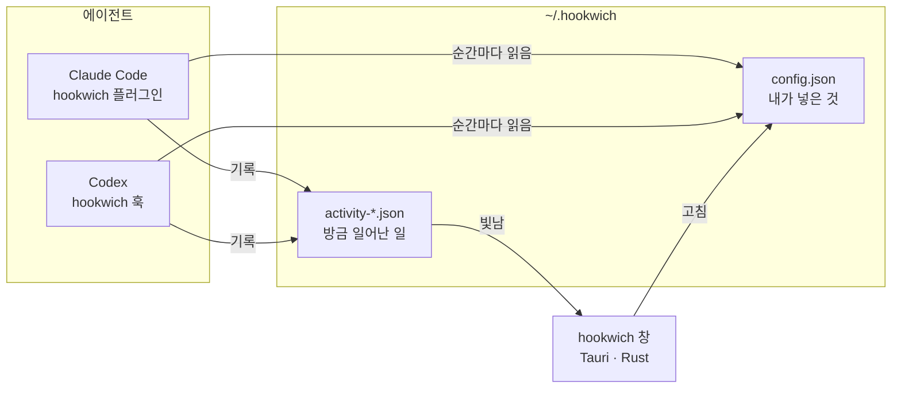

<p align="center">
  
</p>

<h1 align="center">hookwich (훅위치)</h1>

<p align="center">
  <b>코딩 에이전트가 일하는 순간 사이사이에, 원하는 걸 끼워 넣으세요.</b><br />
  Claude Code와 Codex가 일하는 모든 순간을 그림으로 보여 주고, 그 순간마다 말·명령·스킬을 넣을 수 있는 작은 창이에요.
</p>

<p align="center">
  <a href="https://github.com/minjund/hookwich/releases/latest"></a>
  <a href="LICENSE"></a>
  
  
  <a href="https://github.com/minjund/hookwich/stargazers"></a>
</p>

<p align="center">
  <a href="#설치">설치</a> · <a href="#바로-써-보기">바로 써 보기</a> · <a href="#어떻게-돌아가나요">어떻게 돌아가나요</a> · <a href="#자주-묻는-것">자주 묻는 것</a> · <a href="https://github.com/minjund/hookwich/releases">릴리스</a>
</p>

<p align="center">
  <a href="README.md">English</a> · <b>한국어</b> · <a href="README.ja.md">日本語</a> · <a href="README.zh.md">中文</a>
</p>

<p align="center">
  
</p>

```sh
claude plugin install hookwich --marketplace minjund/hookwich
```

---

Claude Code나 Codex가 일할 때는 같은 순간이 계속 돌아와요. 대화가 시작되고, 내가 메시지를 보내고,
도구를 쓰려 하고, 답을 마쳐요. 이 순간 하나하나가 **훅**이고, 훅은 에이전트에게 내 습관을 가르치는
방법이에요. 그런데 훅은 대부분의 사람이 열어 보지 않는 JSON 파일 안에 있어요.

**hookwich는 그걸 화면에 꺼내 놓아요.** 화면 구석에 작은 창이 떠서 순간들을 그림으로 그리고,
누르기만 하면 그 순간에 무엇이든 넣을 수 있어요. 코드도, 설정 파일도 필요 없어요.

## 할 수 있는 것

- **모든 순간을 한눈에** — 공식 [Claude Code 훅 라이프사이클 그림](https://code.claude.com/docs/en/hooks#hook-lifecycle)을
  따라 그렸고, Codex는 Codex 그림이 따로 있어요. 상자는 모두 누를 수 있고, 방금 일어난 순간이 빛나요.
- **말, 명령, 스킬** — 말은 그 순간에 에이전트가 읽어요. 명령은 내 컴퓨터에서 돌고 결과를 전해요(항상,
  또는 실패할 때만). 스킬은 이름으로 불러요. 하나씩 켜고 끄고, 한 번만 돌리거나, 특정 도구일 때만 넣을 수 있어요.
- **모든 곳, 프로젝트별, 터미널별** — 가장 가까운 곳이 이겨요. 클릭 한 번으로 다른 곳 설정을 옮겨 올 수 있고,
  덮어쓰지 않으며 되돌리기도 돼요.
- **채팅하는 곳을 따라가요** — 터미널에서 글자를 치기 시작하면 창이 그 AI·프로젝트·터미널로 바뀌어요.
  터미널마다 색이 다르고, 다른 터미널로 옮기면 알려 줘요.
- **이미 있는 훅도 보여요** — 내 설정, 플러그인(훅으로 돌아가는 스킬 포함), Codex의 훅이 회색 숫자로 나오고,
  마우스를 올리면 이름이 보이고, 끄고 다시 켤 수 있어요. Codex 훅은 `/hooks`와 같은 방식으로 꺼서 신뢰가 그대로예요.
- **내가 넣은 것을 한눈에** — 최근에 넣은 것이 아래쪽에 스위치와 함께 나오고, 전체 목록은 곳별로 묶여
  열려요. 누르면 바로 고치는 곳으로 가요.
- **작고 가벼워요** — Tauri(Rust)로 만든 3.7MB 앱이에요. Electron이 아니에요. 열린 채팅을 macOS 커널에서 바로 읽어
  약 7ms에 찾고, 창을 숨기면 아무것도 읽지 않아요.
- **스스로 새 판으로 바뀌어요** — 창은 늘 플러그인과 같은 판이에요. 플러그인이 새 판이 되면 다음 대화에서
  창도 바뀌어요. SHA-256과 서명을 확인한 뒤에요.
- **4개 언어, 밝게·어둡게** — English, 한국어, 日本語, 中文. 컴퓨터 설정을 따르거나 밝게·어둡게 고를 수 있어요.

## 설치

**1. 플러그인** — 터미널에서

```sh
claude plugin install hookwich --marketplace minjund/hookwich
```

또는 Claude Code 안에서

```
/plugin marketplace add minjund/hookwich
/plugin install hookwich@hookwich
```

**2. 창**은 Claude Code 대화를 처음 시작할 때 저절로 받아져요(macOS 11 이상, 애플 실리콘·인텔). 직접 설치하려면:

```sh
mkdir -p ~/.hookwich && cd ~/.hookwich
curl -fsSLO https://github.com/minjund/hookwich/releases/latest/download/Hookwich-macos-arm64.zip
curl -fsSL https://github.com/minjund/hookwich/releases/latest/download/Hookwich-macos-arm64.zip.sha256 | shasum -a 256 -c
ditto -x -k Hookwich-macos-arm64.zip . && open Hookwich.app
```

**3. Codex(선택)** — 창의 Codex 탭에서 **Codex 연결하기**를 누르고, Codex에서 `/hooks`를 한 번 입력해
hookwich 훅을 신뢰해 주세요.

**새 판 받기:** `claude plugin marketplace update hookwich` 다음에 대화를 새로 시작하세요.

## 바로 써 보기

1. Claude Code 대화를 새로 시작하세요. 오른쪽 아래에 🥪 버블이 뜨면 눌러요.
2. **답을 마칠 때**를 누르고, **명령**을 고르고, `npm test`를 적은 뒤 **실패할 때만**을 골라요.
3. Claude에게 고칠 걸 시켜 보세요. 테스트가 실패한 채로 끝내려 하면, 실패 내용을 읽고 통과할 때까지 계속 고쳐요.

`/hookwich`를 입력하면 창을 보이거나 숨겨요. `–`는 버블로 접고, `×`는 메뉴 막대에 숨겨요.

## 어떻게 돌아가나요



- 순간마다 원래 있던 훅이 먼저 돌고, 그다음 hookwich가 가장 가까운 곳(이 터미널, 없으면 이 프로젝트,
  없으면 모든 곳)에서 켜 둔 것을 넣어요.
- 에이전트가 답을 마치려 할 때는 **한 답에 많아야 한 번만** 더 이어 가게 해서 끝없이 반복되지 않아요.
- 모든 것은 내 컴퓨터의 `~/.hookwich`에만 있어요. `config.json`(넣은 것), `activity-claude.json`·`activity-codex.json`,
  `places.json`(본 프로젝트·터미널), `parked.json`(꺼 둔 훅), `control.json`(보이기·숨기기)이에요.
  hookwich가 바꾸는 파일은 먼저 `~/.hookwich/backups/`에 백업해요.

## 자주 묻는 것

**안전한가요?** 넣은 명령은 그 순간이 올 때마다 내 컴퓨터에서, 나와 같은 권한으로 돌아요. 직접 돌려도
괜찮은 명령만 넣으세요. 명령은 30초가 지나면 멈춰요.

**에이전트가 느려지나요?** 말과 스킬은 바로 들어가요. 명령은 그 명령이 도는 만큼 걸려요. 창은 쉬고 있을 때
CPU 1%도 안 쓰고, 숨기면 아무것도 읽지 않아요.

**열 때 macOS가 경고해요.** 앱은 임시 서명은 했지만 애플 공증은 받지 않았어요. 플러그인처럼 `curl`로 받으면
그냥 열려요. 브라우저로 받았다면 `Hookwich.app`을 오른쪽 클릭해서 **열기**를 한 번 고르세요.

**원래 있던 훅을 바꾸나요?** 내가 끄거나 다시 켤 때만 바꾸고, 늘 백업을 남겨요. Codex 훅은 Codex의 `/hooks`와
똑같이 제자리에서 꺼요.

**윈도우·리눅스는요?** 아직이에요. 지금은 창이 macOS 전용이에요.

## 개발자용

```sh
git clone https://github.com/minjund/hookwich && cd hookwich
cd app && npm install
npm run tauri dev                                         # 창 실행
npm run tauri build -- --target universal-apple-darwin    # Hookwich.app 만들기
cd src-tauri && cargo test                                # 창 테스트
cd ../.. && claude plugin test plugin                     # 플러그인 테스트
```

- `plugin/` — Claude Code 쪽이에요(`classic.*` 훅과 `prompt.edit`을 쓰는 TypeScript 모드).
- `app/` — 창이에요. Tauri(Rust) + React + 무료 [affectUI](https://www.affectui.com) 컴포넌트, 그리고 Codex 훅 실행기
  (`hookwich hook codex <Event>`)가 들어 있어요.

Node 20+, Rust, Xcode 명령줄 도구가 필요해요.

## 고마운 것들

라이프사이클 그림은 공식 [Claude Code 훅 그림](https://code.claude.com/docs/en/hooks#hook-lifecycle)의 배치를 따라
hookwich가 새로 그린 거예요. 그림 파일은 들어 있지 않아요. UI 부품은 [affectUI](https://www.affectui.com)(무료 항목, MIT)에서
가져왔어요. 그림 일부와 아이콘은 Codex와 함께 그렸어요.

## 라이선스

[MIT](LICENSE)
