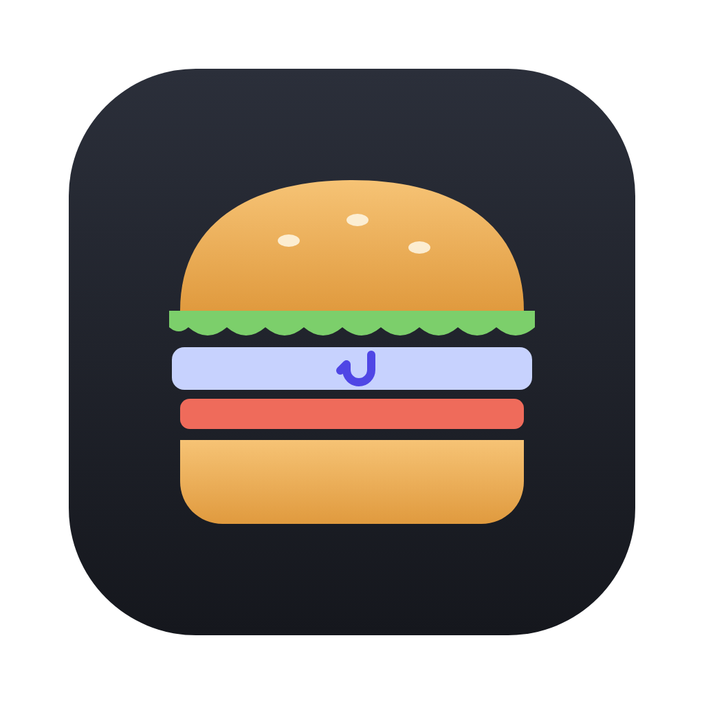
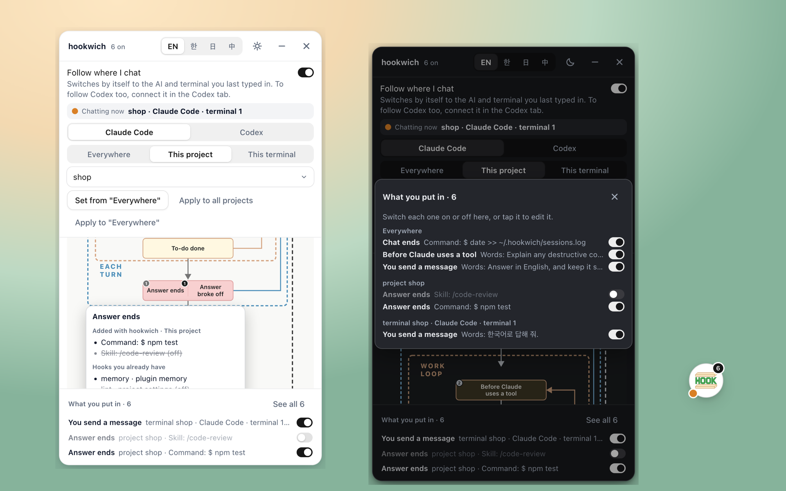
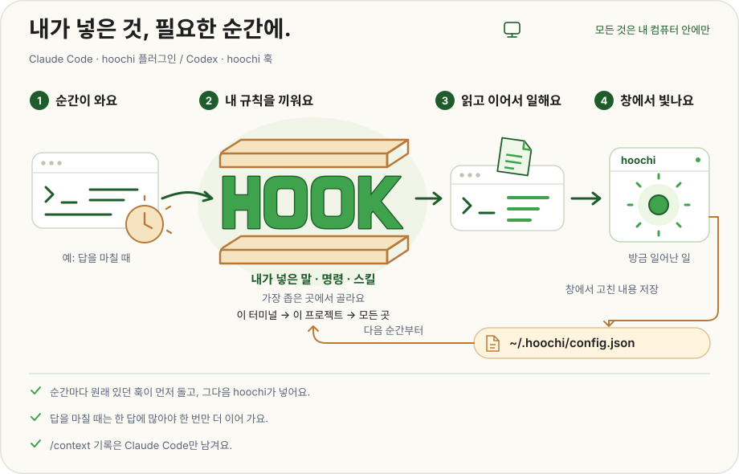

<p align="center">
  
</p>

<h1 align="center">hookwich (훅위치)</h1>

<p align="center">
  <b>코딩 에이전트의 모든 순간에 내 규칙을 끼워 넣는 리모컨.</b><br />
  Claude Code와 Codex가 일하는 순간을 그림으로 보여 주고, 누르기만 하면 그 순간에 말·명령·스킬이 들어가요. JSON은 한 줄도 안 써요.
</p>

<p align="center">
  <a href="https://github.com/minjund/hookwich/releases/latest"></a>
  <a href="LICENSE"></a>
  
  
  <a href="https://github.com/minjund/hookwich/stargazers"></a>
</p>

<p align="center">
  <a href="#이럴-때-써요">이럴 때 써요</a> · <a href="#설치">설치</a> · <a href="#1분-만에-첫-훅">1분 만에 첫 훅</a> · <a href="#어떻게-돌아가나요">어떻게 돌아가나요</a> · <a href="#자주-묻는-것">자주 묻는 것</a> · <a href="https://github.com/minjund/hookwich/releases">릴리스</a>
</p>

<p align="center">
  <a href="README.md">English</a> · <b>한국어</b> · <a href="README.ja.md">日本語</a> · <a href="README.zh.md">中文</a>
</p>

<p align="center">
  
</p>

```sh
claude plugin install hookwich --marketplace minjund/hookwich
```

---

"테스트 돌려 봤어?" "한국어로 답해 줘." "지우기 전에 이유부터 말해." 에이전트에게 매번 똑같은 말을
하고 있다면, 그 말은 **훅**이 대신할 수 있어요. 문제는 훅이 아무도 열어 보고 싶지 않은 JSON 파일 안에
숨어 있다는 거예요.

**hookwich는 그 JSON을 화면 구석의 작은 창으로 바꿔요.** 에이전트가 일하는 순간이 그림으로 그려지고,
방금 지나간 순간이 빛나요. 상자를 누르고, 넣을 것을 적고, 저장하면 끝이에요. 다음 순간부터 바로 들어가요.

## 이럴 때 써요

| 이런 게 귀찮았다면 | hookwich에서는 | 그러면 |
|---|---|---|
| 테스트가 깨진 채로 "다 했어요"라는 답을 받을 때 | **답을 마칠 때** → 명령 `npm test` → **실패할 때만** | 실패하면 Claude가 실패 내용을 읽고 한 번 더 고쳐요 |
| 메시지마다 "한국어로 답해 줘"를 붙일 때 | **내가 메시지를 보낼 때** → 말 `한국어로 답해 줘` | 모든 메시지에 저절로 붙어요 |
| 위험한 명령이 아무 말 없이 지나갈 때 | **Claude가 도구를 쓰기 전** → 도구 `Bash`만 → 말 `지우거나 덮어쓰는 명령은 이유를 먼저 말해` | 셸 명령을 쓰려 할 때만 그 말이 들어가요 |
| 대화를 열 때마다 브랜치 상태를 설명할 때 | **대화 시작** → 명령 `git status -sb` | Claude가 지금 상태를 알고 시작해요 |
| 이 저장소에서만 지킬 규칙이 있을 때 | **이 프로젝트** 탭에서 넣기 | 그 프로젝트의 대화에만 들어가고, 다른 곳은 그대로예요 |
| 리뷰용 터미널 하나만 다르게 쓰고 싶을 때 | **이 터미널** 탭 → **답을 마칠 때** → 스킬 `code-review` | 그 터미널에서만, 답을 마칠 때마다 리뷰를 한 번 더 해요 |
| 딱 한 번만 알려 주고 싶을 때 | 넣을 때 **한 번만** 켜기 | 한 번 돌고 저절로 꺼져요 |
| 플러그인이 무슨 훅을 깔았는지 모를 때 | 회색 숫자가 붙은 순간 누르기 | 무슨 명령을 언제 돌리는지 보이고, 스위치로 꺼요 |
| 대화가 언제 압축될지 몰라 불안할 때 | 그림의 **대화 시작**과 **대화를 줄이기 전** 보기 | 얼마나 찼는지, 자동 압축까지 얼마 남았는지 실시간으로 보여요 |
| 안 쓰는 스킬이 기억 공간을 차지할 때 | **스킬 켜고 끄기** | 끈 스킬은 Claude가 받는 목록에서 빠져요 |

## 할 수 있는 것

- **모든 순간을 한눈에** — 에이전트가 일하는 흐름이 한 장의 워크플로우로. 방금 지나간 순간이 빛나요.
- **말·명령·스킬을 어디에나** — 누르고, 적고, 저장. 실패할 때만, 한 번만, 특정 도구에만도 돼요.
- **모든 곳 · 프로젝트 · 터미널** — 규칙마다 범위를 정하고, 가장 좁은 곳이 이겨요.
- **채팅하는 곳을 따라가요** — 치고 있는 터미널과 그 프로젝트로 창이 알아서 바뀌어요.
- **숨은 훅까지 다 보여요** — 플러그인이 깔아 둔 훅이 무엇을 하는지 보고, 끄고 켜요.
- **/context 실시간** — 얼마나 찼는지, 압축까지 얼마 남았는지 그림 안에서 바로.
- **스킬 켜고 끄기** — 안 쓰는 스킬은 꺼서 기억 공간을 아껴요.
- **버튼 하나로 업데이트** — 열린 대화까지 알아서 새 판으로 바뀌어요.
- **가볍고 조용해요** — 3.8MB 네이티브 앱(Electron 아님). 쉴 때는 CPU를 거의 안 써요.
- **4개 언어 · 밝게·어둡게**

## 설치

**1. 플러그인** — 터미널에서

```sh
claude plugin install hookwich --marketplace minjund/hookwich
```

또는 Claude Code 안에서

```
/plugin marketplace add minjund/hookwich
/plugin install hookwich@hookwich
```

**2. 창**은 Claude Code 대화를 처음 시작할 때 저절로 받아져요(macOS 11 이상, 애플 실리콘·인텔). 직접 설치하려면:

```sh
mkdir -p ~/.hookwich && cd ~/.hookwich
curl -fsSLO https://github.com/minjund/hookwich/releases/latest/download/Hookwich-macos-arm64.zip
curl -fsSL https://github.com/minjund/hookwich/releases/latest/download/Hookwich-macos-arm64.zip.sha256 | shasum -a 256 -c
ditto -x -k Hookwich-macos-arm64.zip . && open Hookwich.app
```

**3. Codex(선택)** — 창의 Codex 탭에서 **Codex 연결하기**를 누르고, Codex에서 `/hooks`를 한 번 입력해
hookwich 훅을 신뢰해 주세요.

**새 판 받기:** 창 위쪽의 **업데이트하기**를 누르세요. 손으로 하려면 `claude plugin update hookwich@hookwich`예요.
이미 열린 대화는 몇 초 안에 스스로 `/reload-plugins`를 해서 바뀌어요(0.1.16부터. 그보다 예전 판에서 올릴 때만
열린 대화마다 한 번 직접 치세요). hookwich를 설치하기 전에 열어 둔 대화에는 hookwich가 없으니, 그 대화는 새로
시작하세요(`claude --continue`로 이어 갈 수 있어요).

## 1분 만에 첫 훅

1. Claude Code 대화를 새로 시작하세요. 오른쪽 아래에 🥪 버블이 뜨면 눌러요.
2. 그림에서 **답을 마칠 때**를 누르고, **여기에 넣기** → **명령**을 고르고, `npm test`를 적은 뒤 **실패할 때만**을 골라요.
3. **저장하기**를 눌러요.
4. Claude에게 고칠 걸 시켜 보세요. 테스트가 실패한 채로 끝내려 하면, Claude가 실패 내용을 읽고 한 번 더 고쳐요.

`/hookwich`를 입력하면 창을 보이거나 숨겨요. `–`는 버블로 접고, `×`는 메뉴 막대에 숨겨요.

## 어떻게 돌아가나요

<p align="center">
  
</p>

- 파일은 모두 `~/.hookwich`에 있어요: `config.json`(넣은 것), `activity-*.json`(방금 일어난 일), `places.json`(본 프로젝트·터미널),
  `parked.json`(꺼 둔 훅), `context/`(터미널별 /context). hookwich가 남의 설정 파일을 바꿀 때는 먼저 `~/.hookwich/backups/`에 백업해요.

## 자주 묻는 것

**안전한가요?** 넣은 명령은 그 순간이 올 때마다 내 컴퓨터에서, 나와 같은 권한으로 돌아요. 직접 돌려도
괜찮은 명령만 넣으세요. 명령은 30초가 지나면 멈춰요.

**에이전트가 느려지나요?** 말과 스킬은 바로 들어가요. 명령은 그 명령이 도는 만큼 걸려요.

**열 때 macOS가 경고해요.** 앱은 임시 서명은 했지만 애플 공증은 받지 않았어요. 플러그인처럼 `curl`로 받으면
그냥 열려요. 브라우저로 받았다면 `Hookwich.app`을 오른쪽 클릭해서 **열기**를 한 번 고르세요.

**원래 있던 훅을 바꾸나요?** 내가 끄거나 다시 켤 때만 바꾸고, 늘 백업을 남겨요. Codex 훅은 Codex의 `/hooks`와
똑같이 제자리에서 꺼요.

**스킬이 많다는데 목록엔 왜 적어요?** 스킬 창은 여기서 켜고 끌 수 있는 것만 보여 줘요. claude.ai에서 동기화된
스킬은 claude.ai에서 켜고 끄고, 플러그인 스킬은 플러그인째로만 꺼져서 플러그인 한 줄로 나와요.

**윈도우·리눅스는요?** 아직이에요. 지금은 창이 macOS 전용이에요.

## 개발자용

```sh
git clone https://github.com/minjund/hookwich && cd hookwich
cd app && npm install
npm run tauri dev                                         # 창 실행
npm run tauri build -- --target universal-apple-darwin    # Hookwich.app 만들기
npm test                                                  # 창의 상태 기계 테스트
cd src-tauri && cargo test                                # 창(Rust) 테스트
cd ../.. && claude plugin test plugin                     # 플러그인 테스트
```

- `plugin/` — Claude Code 쪽이에요(`classic.*` 훅, `prompt.submit`·`prompt.edit`, `/context` 기록을 쓰는 TypeScript 모드).
- `app/` — 창이에요. Tauri(Rust) + React + 무료 [affectUI](https://www.affectui.com) 컴포넌트, 그리고 Codex 훅 실행기
  (`hookwich hook codex <Event>`)가 들어 있어요. 창의 상태(저장, 업데이트, 알림, 따라가기)는 `app/src/lib/machines.ts`에
  적혀 있어요. 에이전트용 안내는 [AGENTS.md](AGENTS.md)에 있어요.

Node 23.6+, Rust, Xcode 명령줄 도구가 필요해요.

## 라이선스

[MIT](LICENSE)
