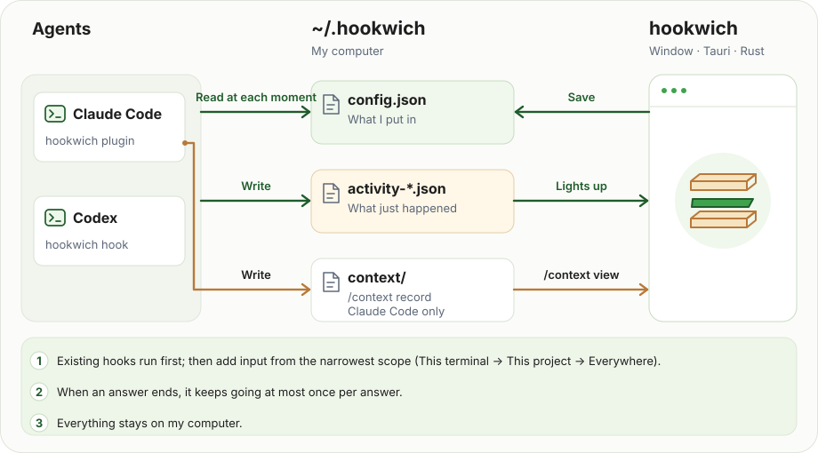

<p align="center">
  
</p>

<h1 align="center">hoochi</h1>

<p align="center">
  <b>A remote control for every moment of your coding agent.</b><br />
  It draws each moment of Claude Code and Codex at work. Tap one and your words, commands or skills go in there. No JSON to write.
</p>

<p align="center">
  <a href="https://github.com/minjund/hoochi/releases/latest"></a>
  <a href="LICENSE"></a>
  
  
  <a href="https://github.com/minjund/hoochi/stargazers"></a>
</p>

<p align="center">
  <a href="#what-people-use-it-for">Use cases</a> · <a href="#install">Install</a> · <a href="#your-first-hook-in-a-minute">First hook</a> · <a href="#how-it-works">How it works</a> · <a href="#faq">FAQ</a> · <a href="https://github.com/minjund/hoochi/releases">Releases</a>
</p>

<p align="center">
  <b>English</b> · <a href="README.ko.md">한국어</a> · <a href="README.ja.md">日本語</a> · <a href="README.zh.md">中文</a>
</p>

<p align="center">
  
</p>

```sh
claude plugin install hoochi --marketplace minjund/hoochi
```

---

"Did you run the tests?" "Answer in English." "Tell me why before you delete anything." If you keep
telling your agent the same things, a **hook** can say them for you. The catch: hooks live in JSON
files nobody wants to open.

**hoochi turns that JSON into a small window in the corner of your screen.** The moments of your
agent's work are drawn as a picture, and the one that just happened lights up. Tap a box, write what
goes in, press Save. It applies from the next moment on.

## What people use it for

| If this annoys you | In hoochi | Then |
|---|---|---|
| "All done!" while the tests are red | **Answer ends** → Command `npm test` → **Only if it fails** | On a failure, Claude reads it and fixes once more |
| Adding "answer in English" to every message | **You send a message** → Words `Answer in English` | It goes with every message |
| A risky command slipping by without a word | **Before Claude uses a tool** → only `Bash` → Words `Explain why before deleting or overwriting anything` | Said only when Claude is about to run a shell command |
| Explaining the branch every time a chat opens | **Chat starts** → Command `git status -sb` | Claude starts knowing where things stand |
| Rules that apply to one repo only | Add them on the **This project** tab | Only that project's chats get them |
| One terminal kept for reviews | **This terminal** tab → **Answer ends** → Skill `code-review` | In that terminal only, a review runs once more after each answer |
| A reminder you need once per chat | Turn on **Once per chat** | It runs once in a chat; a new chat or /clear runs it again |
| Not knowing what hooks a plugin installed | Tap a moment with a gray number | See the command it runs and when, and switch it off |
| Wondering when the chat will be compacted | Look at **Chat starts** and **Before the chat is shortened** in the picture | How full the chat is, and how far to auto-compact, live |
| Skills you never use taking up room | **Turn skills on and off** | A skill you switch off leaves the list Claude is shown |

## What it does

- **Every moment at a glance.** Your agent's whole flow as one workflow picture. The moment that just happened lights up.
- **Words, commands, skills, anywhere.** Tap, write, save. Only on failure, just once, or only for certain tools.
- **Everywhere · per project · per terminal.** Scope each rule; the narrowest one wins.
- **Follows where you chat.** The window switches to the terminal you are typing in, and its project.
- **Even the hidden hooks.** See what the hooks your plugins and apps installed actually do, which app put each one there, and switch them off and on.
- **/context, live.** How full the chat is and how far to auto-compact, right inside the picture.
- **Skills on and off.** Switch off the skills you never use and save room.
- **One-button updates.** Even chats already open move to the new version by themselves.
- **Light and quiet.** A 3.8 MB native app (not Electron) that uses next to no CPU while idle.
- **Four languages · light and dark.**

## Install

> **Used hookwich before?** It is now called hoochi. Install the new plugin, then remove the old one: `claude plugin install hoochi --marketplace minjund/hoochi`, then `claude plugin uninstall hookwich@hookwich`. The first chat with the new plugin moves what you put in from `~/.hookwich` to `~/.hoochi`, and the window points the Codex hooks at itself.

**1. The plugin**, in a terminal:

```sh
claude plugin install hoochi --marketplace minjund/hoochi
```

or inside Claude Code:

```
/plugin marketplace add minjund/hoochi
/plugin install hoochi@hoochi
```

**2. The window** downloads itself the first time you start a Claude Code chat (macOS 11 or later, Apple silicon
and Intel). To install it by hand:

```sh
mkdir -p ~/.hoochi && cd ~/.hoochi
curl -fsSLO https://github.com/minjund/hoochi/releases/latest/download/Hoochi-macos-arm64.zip
curl -fsSL https://github.com/minjund/hoochi/releases/latest/download/Hoochi-macos-arm64.zip.sha256 | shasum -a 256 -c
ditto -x -k Hoochi-macos-arm64.zip . && open Hoochi.app
```

**3. Codex (optional).** On the window's Codex tab press **Connect Codex**, then type `/hooks` once in Codex and
trust the hoochi hooks.

**Updating:** press **Update** at the top of the window, or run `claude plugin update hoochi@hoochi`. Chats
already open reload into the new version within seconds (from 0.1.16 on; coming from an older version, type
`/reload-plugins` once in each open chat). A chat opened before hoochi was installed has no hoochi in it: start
it again (`claude --continue` picks the conversation back up).

## Your first hook in a minute

1. Start a new Claude Code chat. When the 🥪 bubble appears at the bottom right, click it.
2. Tap **Answer ends** in the picture, then **Add something here** → **Command**, type `npm test` and pick
   **Only if it fails**.
3. Press **Save**.
4. Ask Claude to fix something. If it tries to finish with the tests failing, it reads the failure and fixes once more.

Type `/hoochi` to show or hide the window. `×` folds it into the bubble; right-click the bubble to hide it in the menu bar.

## How it works

<p align="center">
  
</p>

- The files, all in `~/.hoochi`: `config.json` (what you put in), `activity-*.json` (what just happened), `places.json` (projects and
  terminals seen), `parked.json` (hooks switched off), `once-*.json` (once-per-chat items each chat already ran), `context/` (/context per terminal). Any settings file hoochi changes is backed up
  first in `~/.hoochi/backups/`.

## FAQ

**Is it safe?** A command you put in runs on your computer, with your permissions, each time its moment comes.
Only put in commands you would run yourself. Commands stop after 30 seconds.

**Does it slow the agent down?** Words and skills go in at once. A command takes as long as it runs.

**macOS warns when I open it.** The app is ad-hoc signed but not notarized by Apple. Downloaded with `curl` (as the
plugin does) it just opens. If you downloaded it in a browser, right-click `Hoochi.app` and choose **Open** once.

**Does it change my existing hooks?** Only when you switch one off or back on, and always with a backup. Codex hooks
are switched in place, the same way Codex's `/hooks` does.

**I have lots of skills; why is the list shorter?** The skills popup lists only what can be switched from there.
Skills synced from claude.ai are switched on claude.ai, and a plugin's skills switch only with the whole plugin, so
each plugin is one row.

**Windows or Linux?** Not yet; the window is macOS only for now.

## For developers

```sh
git clone https://github.com/minjund/hoochi && cd hoochi
cd app && npm install
npm run tauri dev                                         # run the window
npm run tauri build -- --target universal-apple-darwin    # build Hoochi.app
npm test                                                  # the window's state machines
cd src-tauri && cargo test                                # the window (Rust)
cd ../.. && claude plugin test plugin                     # the plugin
```

- `plugin/` is the Claude Code side: a TypeScript mod using `classic.*` hooks, `prompt.submit` and `prompt.edit`,
  and the /context record.
- `app/` is the window: Tauri (Rust) + React + free [affectUI](https://www.affectui.com) components, and the Codex hook
  runner (`hoochi hook codex <Event>`). The window's states (saving, updating, notices, following) are written out
  in `app/src/lib/machines.ts`. Notes for coding agents are in [AGENTS.md](AGENTS.md).

Needs Node 23.6+, Rust and the Xcode command line tools.

## License

[MIT](LICENSE)
