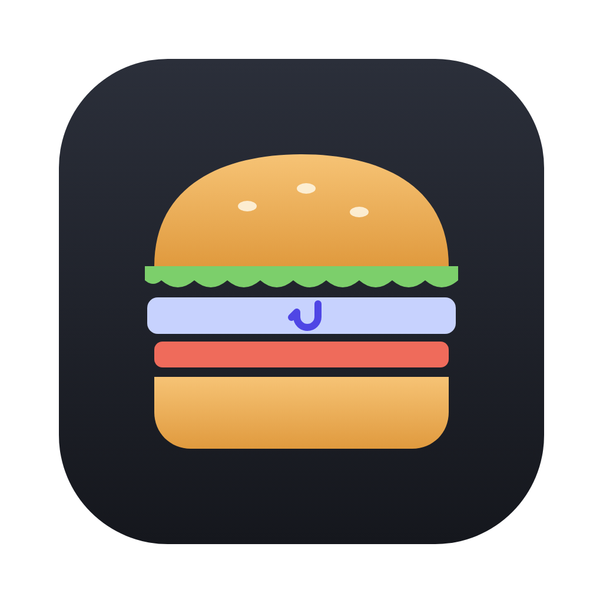
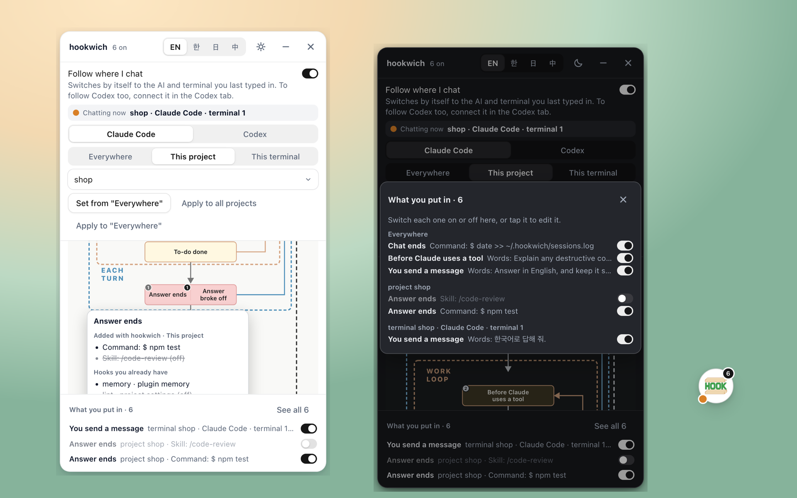
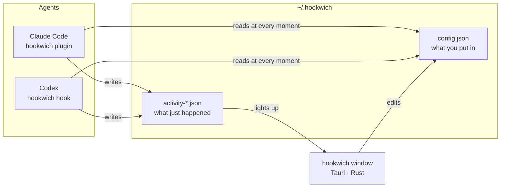

<p align="center">
  
</p>

<h1 align="center">hookwich</h1>

<p align="center">
  <b>Put anything between the moments of your coding agent's work.</b><br />
  A small window that draws every moment of Claude Code and Codex, and lets you slip words, commands or skills into any of them.
</p>

<p align="center">
  <a href="https://github.com/minjund/hookwich/releases/latest"></a>
  <a href="LICENSE"></a>
  
  
  <a href="https://github.com/minjund/hookwich/stargazers"></a>
</p>

<p align="center">
  <a href="#install">Install</a> · <a href="#quick-start">Quick start</a> · <a href="#how-it-works">How it works</a> · <a href="#faq">FAQ</a> · <a href="https://github.com/minjund/hookwich/releases">Releases</a>
</p>

<p align="center">
  <b>English</b> · <a href="README.ko.md">한국어</a> · <a href="README.ja.md">日本語</a> · <a href="README.zh.md">中文</a>
</p>

<p align="center">
  
</p>

```sh
claude plugin install hookwich --marketplace minjund/hookwich
```

---

Every time Claude Code or Codex works, the same moments come around: a chat starts, you send a
message, a tool is about to run, the answer ends. Each of these is a **hook**, and hooks are how you
teach an agent your habits. They live in JSON files most people never open.

**hookwich puts them on screen.** A little window floats in the corner, draws the lifecycle as a
picture, and lets you put something into any moment with a click: no code, no config files.

## Features

- **See every moment** — the lifecycle is drawn after the official
  [Claude Code hooks figure](https://code.claude.com/docs/en/hooks#hook-lifecycle), and Codex has its
  own. Every box is clickable, and the moment that just happened lights up.
- **Words, a command, or a skill** — words are read by the agent at that moment; a command runs on
  your machine and hands back its output (always, or only when it fails); a skill is called by name.
  Switch each one on or off, run it just once, or limit it to certain tools.
- **Everywhere, per project, per terminal** — the closest one wins. Copy settings between places with
  one click, never overwriting, with an undo.
- **Follows where you chat** — start typing in a terminal and the window switches to that AI, project
  and terminal. Each terminal has its own color, and you are told when you move to another one.
- **Your existing hooks, in plain view** — hooks from your settings, your plugins (often a skill run by
  a hook) and Codex show as grey numbers, by name on hover, and can be switched off and back on.
  Codex keeps its trust, the same way `/hooks` does it.
- **What you put in, at a glance** — your newest items sit at the bottom with a switch each; the full
  list opens grouped by place, one tap away from editing.
- **/context, live** — the context fill of the chat you are in sits under "Chatting now" as a bar
  that moves while Claude works, and opens into what /context lists: each part, memory files, MCP
  servers and skills, and where it will compact. Counted on your machine, no extra requests.
- **Small and native** — Tauri (Rust), a 3.7 MB download, no Electron. It finds open chats straight
  from the macOS kernel in about 7 ms and reads nothing while hidden.
- **Updates itself** — the window always matches the plugin: a newer plugin swaps the window on the
  next chat, after checking its SHA-256 and signature.
- **Four languages, light and dark** — English, 한국어, 日本語, 中文; your computer's look, light or dark.

## Install

**1. The plugin.** In a terminal:

```sh
claude plugin install hookwich --marketplace minjund/hookwich
```

or inside Claude Code:

```
/plugin marketplace add minjund/hookwich
/plugin install hookwich@hookwich
```

**2. The window** downloads itself the first time a Claude Code chat starts (macOS 11 or later, Apple
silicon or Intel). To install it by hand instead:

```sh
mkdir -p ~/.hookwich && cd ~/.hookwich
curl -fsSLO https://github.com/minjund/hookwich/releases/latest/download/Hookwich-macos-arm64.zip
curl -fsSL https://github.com/minjund/hookwich/releases/latest/download/Hookwich-macos-arm64.zip.sha256 | shasum -a 256 -c
ditto -x -k Hookwich-macos-arm64.zip . && open Hookwich.app
```

**3. Codex (optional).** In the window's Codex tab press **Connect Codex**, then type `/hooks` in
Codex once and trust the hookwich hooks.

**Update:** `claude plugin marketplace update hookwich`, then start a new chat.

## Quick start

1. Start a new Claude Code chat. A 🥪 bubble appears in the bottom-right corner; click it.
2. Click **Answer ends**, choose **Command**, type `npm test` and pick **Only if it fails**.
3. Ask Claude for a change. When it tries to finish with failing tests, it reads the failure and keeps
   going until they pass.

Type `/hookwich` to show or hide the window. `–` folds it into the bubble, `×` hides it in the menu bar.

## How it works



- At every moment, your existing hooks run first; then hookwich adds what is switched on for the
  closest place (this terminal, else this project, else everywhere).
- When the agent is about to finish, hookwich asks it to keep going **at most once per answer**, so it
  never loops.
- Everything stays on your computer, in `~/.hookwich`: `config.json` (what you put in),
  `activity-claude.json` and `activity-codex.json`, `places.json` (projects and terminals seen),
  `parked.json` (hooks you switched off), `control.json` (show or hide) and `context/` (what
  /context shows, per terminal). Files hookwich changes are
  backed up first in `~/.hookwich/backups/`.

## FAQ

**Is it safe?** A command you add runs on your computer with your rights, every time its moment comes.
Only add commands you would run yourself. Each one is stopped after 30 seconds.

**Will it slow my agent down?** Words and skills are instant. A command takes as long as it runs. The
window itself sits idle at well under 1% CPU and reads nothing while hidden.

**Why does macOS warn me when I open it?** The app is ad-hoc signed but not notarized by Apple.
Downloaded with `curl` (as the plugin does) it opens normally; from a browser, right-click
`Hookwich.app` and choose **Open** once.

**Does it change my existing hooks?** Only when you switch one off or back on, and always with a
backup. Codex hooks are switched in place, exactly as Codex's own `/hooks` does.

**Windows or Linux?** Not yet: the window is macOS only for now.

## Development

```sh
git clone https://github.com/minjund/hookwich && cd hookwich
cd app && npm install
npm run tauri dev                                         # run the window
npm run tauri build -- --target universal-apple-darwin    # make Hookwich.app
cd src-tauri && cargo test                                # the window's tests
cd ../.. && claude plugin test plugin                     # the plugin's tests
```

- `plugin/` — the Claude Code part (a TypeScript mod on `classic.*` hooks and `prompt.edit`).
- `app/` — the window: Tauri (Rust) + React + free [affectUI](https://www.affectui.com) components,
  and the Codex hook runner (`hookwich hook codex <Event>`).

Needs Node 20+, Rust and the Xcode command line tools.

## Credits

The lifecycle picture is hookwich's own drawing of the layout of the official
[Claude Code hooks figure](https://code.claude.com/docs/en/hooks#hook-lifecycle); the figure's file is
not included. UI parts from [affectUI](https://www.affectui.com) (free items, MIT). Parts of the
picture and the icon were drawn with Codex.

## License

[MIT](LICENSE)
