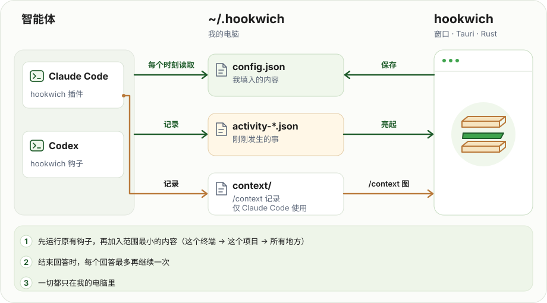

<p align="center">
  
</p>

<h1 align="center">hookwich</h1>

<p align="center">
  <b>给编码智能体的每个时刻插入你自己的规则的遥控器。</b><br />
  把 Claude Code 和 Codex 工作的时刻画成图，点一下就能在那个时刻放进文字、命令或技能。一行 JSON 都不用写。
</p>

<p align="center">
  <a href="https://github.com/minjund/hookwich/releases/latest"></a>
  <a href="LICENSE"></a>
  
  
  <a href="https://github.com/minjund/hookwich/stargazers"></a>
</p>

<p align="center">
  <a href="#适合这些时候">适合这些时候</a> · <a href="#安装">安装</a> · <a href="#一分钟做出第一个钩子">一分钟做出第一个钩子</a> · <a href="#工作原理">工作原理</a> · <a href="#常见问题">常见问题</a> · <a href="https://github.com/minjund/hookwich/releases">发布</a>
</p>

<p align="center">
  <a href="README.md">English</a> · <a href="README.ko.md">한국어</a> · <a href="README.ja.md">日本語</a> · <b>中文</b>
</p>

<p align="center">
  
</p>

```sh
claude plugin install hookwich --marketplace minjund/hookwich
```

---

"测试跑过了吗？""请用中文回答。""删东西之前先说理由。"如果你总是对智能体说同样的话，这些话可以交给**钩子**来说。
问题是，钩子藏在没人想打开的 JSON 文件里。

**hookwich 把那些 JSON 变成屏幕角落里的一个小窗口。** 智能体工作的时刻被画成一张图，刚刚发生的时刻会亮起来。
点一个方框，写下要放进去的内容，按保存就好。从下一个时刻起马上生效。

## 适合这些时候

| 如果你烦这些 | 在 hookwich 里 | 结果 |
|---|---|---|
| 测试还红着就说"做完了" | **回答结束** → 命令 `npm test` → **只在失败时** | 失败时 Claude 会读失败内容，再修一次 |
| 每条消息都要加"请用中文回答" | **发送消息时** → 文字 `请用中文回答` | 自动跟着每条消息一起发 |
| 危险命令悄无声息地执行 | **使用工具前** → 只对 `Bash` → 文字 `删除或覆盖之前先说明理由` | 只在要运行 shell 命令时加入这句话 |
| 每次打开对话都要解释分支状态 | **对话开始** → 命令 `git status -sb` | Claude 一开始就知道现在的状态 |
| 只在这个仓库里要遵守的规则 | 在 **这个项目** 标签里添加 | 只进入这个项目的对话 |
| 想让一个终端专门做审查 | **这个终端** 标签 → **回答结束** → 技能 `code-review` | 只在那个终端里，每次回答后再审查一次 |
| 只想提醒一次 | 添加时打开 **只一次** | 运行一次后自动关闭 |
| 不知道插件装了哪些钩子 | 点带灰色数字的时刻 | 看到它在什么时候运行什么命令，并能用开关关掉 |
| 担心对话什么时候被压缩 | 看图里的 **对话开始** 和 **缩短对话前** | 实时显示用了多少、离自动压缩还剩多少 |
| 不用的技能占着空间 | **开关技能** | 关掉的技能会从 Claude 收到的列表里去掉 |

## 能做什么

- **一眼看清每个时刻** — 智能体的整个流程画成一张工作流程图，刚发生的时刻会亮起来。
- **文字、命令、技能，放在任何时刻** — 点一下、写下来、保存。只在失败时、只一次、只对某些工具都可以。
- **所有地方 · 项目 · 终端** — 每条规则自己定范围，范围最小的优先。
- **跟着你聊天的地方走** — 窗口自动切到你正在输入的终端和它的项目。
- **连隐藏的钩子也看得到** — 看清插件装的钩子在做什么，随时开关。
- **/context 实时显示** — 用了多少、离压缩还剩多少，直接在图里看。
- **开关技能** — 关掉不用的技能，省出空间。
- **一键更新** — 连已打开的对话也会自动换成新版本。
- **轻巧安静** — 3.8MB 的原生应用（不是 Electron），空闲时几乎不占 CPU。
- **四种语言 · 浅色与深色**

## 安装

**1. 插件**，在终端里：

```sh
claude plugin install hookwich --marketplace minjund/hookwich
```

或在 Claude Code 里：

```
/plugin marketplace add minjund/hookwich
/plugin install hookwich@hookwich
```

**2. 窗口**会在你第一次开始 Claude Code 对话时自动下载（macOS 11 及以上，Apple 芯片与 Intel）。手动安装：

```sh
mkdir -p ~/.hookwich && cd ~/.hookwich
curl -fsSLO https://github.com/minjund/hookwich/releases/latest/download/Hookwich-macos-arm64.zip
curl -fsSL https://github.com/minjund/hookwich/releases/latest/download/Hookwich-macos-arm64.zip.sha256 | shasum -a 256 -c
ditto -x -k Hookwich-macos-arm64.zip . && open Hookwich.app
```

**3. Codex（可选）** 在窗口的 Codex 标签里按 **连接 Codex**，然后在 Codex 里输入一次 `/hooks`，信任 hookwich 的钩子。

**更新：** 按窗口上方的 **更新**，或运行 `claude plugin update hookwich@hookwich`。已打开的对话几秒内会自己换成新版本
（从 0.1.16 起；从更早的版本升级时，请在每个已打开的对话里手动输入一次 `/reload-plugins`）。安装 hookwich 之前打开的对话里没有 hookwich，
请重新开始那个对话（`claude --continue` 可以接着之前的对话）。

## 一分钟做出第一个钩子

1. 新开一个 Claude Code 对话。右下角出现 🥪 气泡后点它。
2. 在图里点 **回答结束**，再点 **在这里添加** → **命令**，写 `npm test`，选 **只在失败时**。
3. 按 **保存**。
4. 让 Claude 修点什么。如果它想在测试失败的情况下结束，会读失败内容，再修一次。

输入 `/hookwich` 显示或隐藏窗口。`–` 折叠成气泡，`×` 隐藏到菜单栏。

## 工作原理

<p align="center">
  
</p>

- 文件都在 `~/.hookwich`：`config.json`（加入的内容）、`activity-*.json`（刚发生的事）、`places.json`（见过的项目和终端）、
  `parked.json`（关掉的钩子）、`context/`（每个终端的 /context）。hookwich 修改其他设置文件前，会先备份到 `~/.hookwich/backups/`。

## 常见问题

**安全吗？** 加入的命令每到那个时刻就在你的电脑上、以你的权限运行。只放你自己也愿意运行的命令。命令 30 秒后会停止。

**会让智能体变慢吗？** 文字和技能立即加入。命令要花它运行的时间。

**打开时 macOS 有警告。** 应用做了临时签名，但没有经过 Apple 公证。像插件那样用 `curl` 下载就能直接打开。
如果是用浏览器下载的，右键 `Hookwich.app` 选一次 **打开**。

**会改我原有的钩子吗？** 只有在你关掉或重新打开时才会，而且总会先备份。Codex 钩子和 Codex 自己的 `/hooks` 一样在原处切换。

**我有很多技能，为什么列表比较短？** 技能窗口只列出在那里能开关的。从 claude.ai 同步的技能在 claude.ai 上开关，插件的技能只能随整个插件开关，
所以每个插件只占一行。

**Windows 和 Linux 呢？** 还没有，现在窗口只支持 macOS。

## 开发者

```sh
git clone https://github.com/minjund/hookwich && cd hookwich
cd app && npm install
npm run tauri dev                                         # 运行窗口
npm run tauri build -- --target universal-apple-darwin    # 构建 Hookwich.app
npm test                                                  # 窗口的状态机测试
cd src-tauri && cargo test                                # 窗口（Rust）测试
cd ../.. && claude plugin test plugin                     # 插件测试
```

- `plugin/` 是 Claude Code 这一侧：用 `classic.*` 钩子、`prompt.submit` 与 `prompt.edit` 和 /context 记录的 TypeScript 模组。
- `app/` 是窗口：Tauri（Rust）+ React + 免费的 [affectUI](https://www.affectui.com) 组件，以及 Codex 钩子运行器（`hookwich hook codex <Event>`）。
  窗口的状态（保存、更新、提示、跟随）写在 `app/src/lib/machines.ts` 里。给编码智能体的说明在 [AGENTS.md](AGENTS.md)。

需要 Node 23.6+、Rust 和 Xcode 命令行工具。

## 许可证

[MIT](LICENSE)
