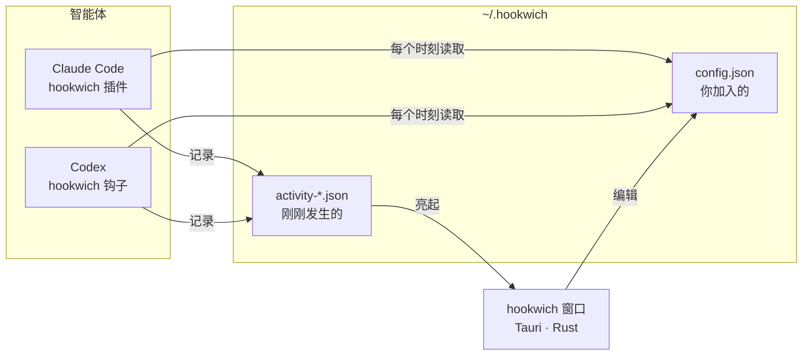

<p align="center">
  
</p>

<h1 align="center">hookwich</h1>

<p align="center">
  <b>在编码智能体工作的每个时刻之间，夹进你想要的任何东西。</b><br />
  一个小窗口，把 Claude Code 和 Codex 工作的每个时刻画成图，让你在任意时刻加入文字、命令或技能。
</p>

<p align="center">
  <a href="https://github.com/minjund/hookwich/releases/latest"></a>
  <a href="LICENSE"></a>
  
  
  <a href="https://github.com/minjund/hookwich/stargazers"></a>
</p>

<p align="center">
  <a href="#安装">安装</a> · <a href="#马上试试">马上试试</a> · <a href="#工作原理">工作原理</a> · <a href="#常见问题">常见问题</a> · <a href="https://github.com/minjund/hookwich/releases">发布</a>
</p>

<p align="center">
  <a href="README.md">English</a> · <a href="README.ko.md">한국어</a> · <a href="README.ja.md">日本語</a> · <b>中文</b>
</p>

<p align="center">
  
</p>

```sh
claude plugin install hookwich --marketplace minjund/hookwich
```

---

Claude Code 或 Codex 工作时，同样的时刻会一再出现：对话开始、你发送消息、准备使用工具、回答结束。
每个时刻都是一个 **钩子（hook）**，而钩子正是教会智能体你的习惯的方式。可它们藏在大多数人从不打开的 JSON 文件里。

**hookwich 把它们搬到屏幕上。** 屏幕角落浮着一个小窗口，把这些时刻画成图，点一下就能往任意时刻里加东西。
不用写代码，也不用改配置文件。

## 功能

- **一眼看到每个时刻** — 参照官方 [Claude Code 钩子生命周期图](https://code.claude.com/docs/en/hooks#hook-lifecycle) 绘制，
  Codex 也有自己的图。每个方框都能点，刚刚发生的时刻会亮起来。
- **文字、命令或技能** — 文字会在那一刻被智能体读到；命令在你的电脑上运行并交回结果（总是，或只在失败时）；技能按名字调用。
  每一项都可单独开关、只运行一次，或只对某些工具生效。
- **所有地方、按项目、按终端** — 最近的那一处优先。一键在不同地方之间复制设置，不会覆盖，还能撤销。
- **跟随你聊天的地方** — 在终端里开始输入，窗口就会切到那个 AI、项目和终端。每个终端颜色不同，换到另一个终端时会提示你。
- **已有的钩子也一目了然** — 你的设置、插件（包括靠钩子运行的技能）和 Codex 里的钩子会显示为灰色数字，鼠标停上去能看到名字，
  还能关掉再打开。Codex 钩子和 `/hooks` 一样在原处切换，信任保持不变。
- **我加入的，一眼可见** — 最近加入的几项带着开关和删除按钮显示在底部；完整列表按位置分组打开，点一下就去编辑。
- **实时的 /context** — 你正在聊天的对话的上下文占用会以进度条显示在「正在聊天」下方，Claude 工作时一直在变。
  下面每一部分都有一个按钮，点开能看到里面有什么：MCP 服务器、记忆文件、按插件分组的技能、智能体，以及会在哪里自动压缩。
  在你的电脑上计算，不会多发请求。
- **小巧原生** — 用 Tauri（Rust）打造，下载只有 3.7MB，不是 Electron。直接从 macOS 内核读取打开的对话，约 7ms 就能找到；
  窗口隐藏时什么都不读。
- **自动更新** — 窗口始终与插件版本一致：插件更新后，下一次对话时窗口也会换成新版，先校验 SHA-256 和签名。
- **四种语言，浅色与深色** — English、한국어、日本語、中文；跟随电脑设置，或选浅色、深色。

## 安装

**1. 插件** — 在终端中

```sh
claude plugin install hookwich --marketplace minjund/hookwich
```

或在 Claude Code 中

```
/plugin marketplace add minjund/hookwich
/plugin install hookwich@hookwich
```

**2. 窗口** 会在第一次开始 Claude Code 对话时自动下载（macOS 11 及以上，Apple 芯片和 Intel 都可以）。要手动安装：

```sh
mkdir -p ~/.hookwich && cd ~/.hookwich
curl -fsSLO https://github.com/minjund/hookwich/releases/latest/download/Hookwich-macos-arm64.zip
curl -fsSL https://github.com/minjund/hookwich/releases/latest/download/Hookwich-macos-arm64.zip.sha256 | shasum -a 256 -c
ditto -x -k Hookwich-macos-arm64.zip . && open Hookwich.app
```

**3. Codex（可选）** — 在窗口的 Codex 标签页按 **连接 Codex**，然后在 Codex 中输入一次 `/hooks`，信任 hookwich 的钩子。

**更新：** 运行 `claude plugin update hookwich@hookwich`，然后重新打开 Claude Code。想自动获取新版本，就在
`/plugin` → **Marketplaces** → hookwich → **Enable auto-update** 打开一次。窗口会在下一次对话时换成与插件相同的版本。

## 马上试试

1. 开始一个新的 Claude Code 对话。右下角出现 🥪 气泡后点它。
2. 点 **回答结束**，选 **命令**，输入 `npm test`，再选 **只在失败时**。
3. 让 Claude 改点东西。如果它想在测试失败时结束，就会读取失败信息并一直修到测试通过。

输入 `/hookwich` 可以显示或隐藏窗口。`–` 收成气泡，`×` 隐藏到菜单栏。

## 工作原理



- 每个时刻，原有的钩子先运行；然后 hookwich 加入最近一处（这个终端，没有就这个项目，再没有就所有地方）中开启的内容。
- 智能体想要结束回答时，**每次回答最多只让它再继续一次**，所以不会无限循环。
- 一切都只在你电脑的 `~/.hookwich` 里：`config.json`（你加入的）、`activity-claude.json` 和 `activity-codex.json`、
  `places.json`（见过的项目和终端）、`parked.json`（你关掉的钩子）、`control.json`（显示或隐藏）、`context/`（每个终端的 /context）。
  hookwich 修改的文件会先备份到 `~/.hookwich/backups/`。

## 常见问题

**安全吗？** 你加入的命令会在每次对应时刻到来时，以和你相同的权限在你的电脑上运行。只加入你自己也愿意运行的命令。
命令超过 30 秒会被停止。

**会让智能体变慢吗？** 文字和技能立即生效；命令运行多久就花多久。窗口空闲时 CPU 不到 1%，隐藏时什么都不读。

**打开时 macOS 发出警告？** 应用做了临时签名，但没有经过 Apple 公证。像插件那样用 `curl` 下载可以直接打开；
如果用浏览器下载，右键点 `Hookwich.app` 选 **打开** 一次即可。

**会改动我原有的钩子吗？** 只有在你关掉或重新打开时才会，而且总会先备份。Codex 钩子和 Codex 自己的 `/hooks` 一样在原处切换。

**支持 Windows 或 Linux 吗？** 暂时不支持，窗口目前只有 macOS 版。

## 开发

```sh
git clone https://github.com/minjund/hookwich && cd hookwich
cd app && npm install
npm run tauri dev                                         # 运行窗口
npm run tauri build -- --target universal-apple-darwin    # 生成 Hookwich.app
cd src-tauri && cargo test                                # 窗口的测试
cd ../.. && claude plugin test plugin                     # 插件的测试
```

- `plugin/` — Claude Code 部分（使用 `classic.*` 钩子和 `prompt.edit` 的 TypeScript 模组）。
- `app/` — 窗口：Tauri（Rust）+ React + 免费的 [affectUI](https://www.affectui.com) 组件，以及 Codex 钩子执行器
  （`hookwich hook codex <Event>`）。

需要 Node 20+、Rust 和 Xcode 命令行工具。

## 致谢

生命周期图是 hookwich 参照官方 [Claude Code 钩子图](https://code.claude.com/docs/en/hooks#hook-lifecycle) 的布局重新绘制的，
不包含原图文件。UI 组件来自 [affectUI](https://www.affectui.com)（免费项目，MIT）。部分图和图标是与 Codex 一起绘制的。

## 许可证

[MIT](LICENSE)
