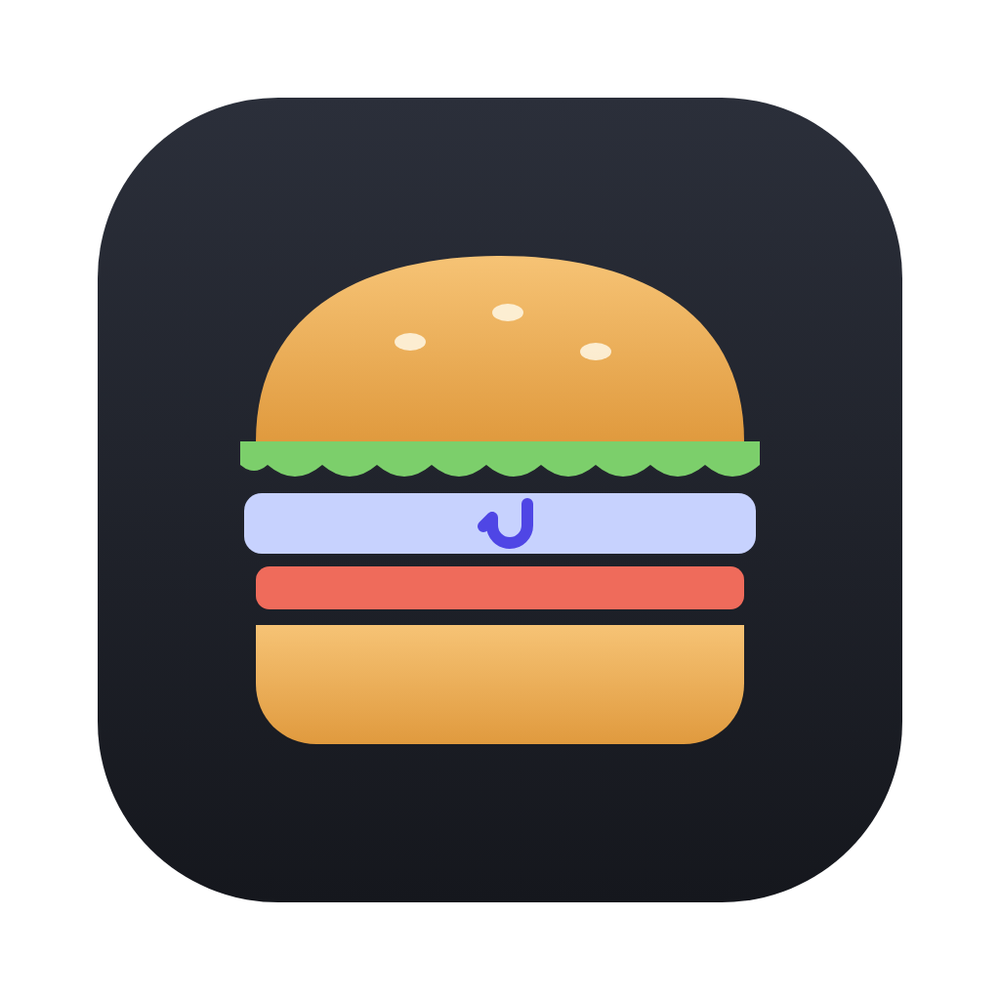
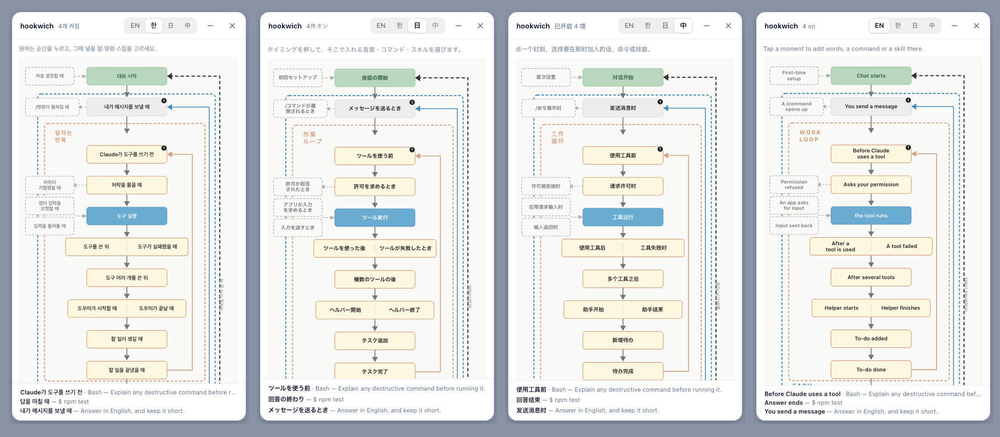

<p align="center"></p>

<h1 align="center">hookwich</h1>

<p align="center"><b>在 Claude Code 工作的那一刻，告诉它你想要什么。</b><br>
屏幕角落的小窗口会用一张图展示 Claude 工作的每个时刻。<br>
点一个时刻，选择要在那时加入的话、命令或技能就行。</p>

<p align="center"><a href="README.md">English</a> · <a href="README.ko.md">한국어</a> · <a href="README.ja.md">日本語</a> · <b>中文</b></p>

---

## 有什么用？

Claude Code 工作时，同样的时刻会一次次出现：对话开始、你发送消息、Claude 使用工具（运行命令、修改文件）、
Claude 回答完毕……

用 hookwich，不用写代码，就能在这些时刻加上你想要的内容。

| 加入 | 会发生什么 | 例子 |
|---|---|---|
| **文字** | Claude 会在那一刻读到。 | 每次发消息时：“请用英文回答。” |
| **命令** | 在你的电脑上运行。结果可以总是交给 Claude，或只在失败时交给它。 | 回答结束时运行 `npm test`，只在失败时 → Claude 会一直修到测试通过。 |
| **技能** | 让 Claude 使用你已安装的某个技能。 | 回答结束时用 `code-review`。 |

每一项都可以开关；选 **只一次** 的话，运行一次后会自动关闭。
在使用工具的时刻，还可以指定只对哪些工具生效。

<p align="center"></p>

## 窗口

- 它以右下角的小 🥪 气泡浮在其他窗口之上，可以拖到任何地方。
- 点气泡就会展开 Claude 工作流程图。它参照官方
  [Claude Code 钩子生命周期图](https://code.claude.com/docs/en/hooks#hook-lifecycle)绘制。
- 点任意方框即可添加内容。方框上的数字表示已开启的项数。
- 刚刚发生的时刻会亮起来，你能看到 Claude 正在做什么。
- `–` 收成气泡，`×` 隐藏；隐藏后它会留在屏幕顶部的菜单栏。
- 语言：English、한국어、日本語、中文。默认跟随电脑语言，可在窗口顶部切换。

## 安装

**1. 插件**：在 Claude Code 中输入下面这行，按 `y`，再选择安装位置。

```
/plugin install hookwich --marketplace minjund/hookwich
```

在终端中则是 `claude plugin install hookwich --marketplace minjund/hookwich`。

**2. 窗口（macOS）**：第一次开始 Claude Code 对话时，插件会从[发布页面](https://github.com/minjund/hookwich/releases)
下载窗口程序，确认文件可信后打开。

输入 `/hookwich` 即可显示或隐藏窗口。

## 安全吗？

你加入的命令会在每次对应时刻到来时，以和你相同的权限在你的电脑上运行。
只加入你自己也愿意运行的命令。命令超过 30 秒会被停止。

## 许可证

MIT
